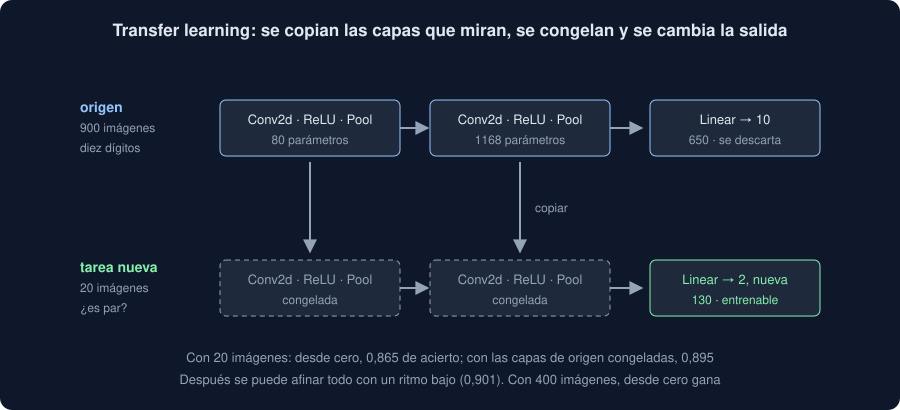

# 04 · Transfer learning

⏱️ 50 min

## 🎯 Objetivos

- Explicar qué es el *transfer learning* y por qué funciona con pocas etiquetas.
- Congelar capas con `requires_grad`, cambiar la capa de salida y entrenar solo lo nuevo.
- Afinar (*fine-tuning*) la red entera con un ritmo pequeño.
- Reconocer cuándo ayuda y cuándo no, con los números del ejercicio 04.
- Usar pesos de otros con cuidado: de dónde vienen, su licencia y `weights_only=True`.

---

## 1. No empezar de cero

Entrenar una red que reconoce fotos necesita millones de imágenes etiquetadas y días de GPU. Tú tienes, quizá, unas decenas de fotos de tu dominio. Pero las primeras capas de cualquier red de imágenes aprenden cosas parecidas: bordes, esquinas, texturas, trazos. Eso sirve casi para cualquier tarea de imágenes.

El **transfer learning** (aprendizaje por transferencia) reutiliza esas capas:

1. Tomas una red **de origen**, entrenada con muchos datos para otra tarea.
2. Copias sus capas que miran la imagen (las convoluciones) y las **congelas**: sus pesos ya no cambian.
3. Cambias la **capa de salida** por una nueva, con las clases de tu tarea.
4. Entrenas solo la salida nueva con tus pocas imágenes.
5. Si hace falta, **afinas** todo después, con un ritmo pequeño.



## 2. Congelar

Un parámetro con `requires_grad=False` no recibe gradiente: `backward()` no le calcula nada y el optimizador no lo mueve. Una red de origen pequeña, para verlo:

```python
import copy

import torch
from torch import nn

torch.manual_seed(35)
source = nn.Sequential(
    nn.Sequential(nn.Conv2d(1, 8, 3, padding=1), nn.ReLU(), nn.MaxPool2d(2), nn.Flatten()),
    nn.Linear(8 * 4 * 4, 10),
)
features = copy.deepcopy(source[0])
for parameter in features.parameters():
    parameter.requires_grad = False
model = nn.Sequential(features, nn.Linear(8 * 4 * 4, 2))


def count(net, trainable=False):
    return sum(p.numel() for p in net.parameters() if p.requires_grad or not trainable)


print(f"parámetros {count(model)} · entrenables {count(model, trainable=True)}")
for name, parameter in model.named_parameters():
    print(f"  {name:<12} {tuple(parameter.shape)} {parameter.requires_grad}")
```

```
parámetros 338 · entrenables 258
  0.0.weight   (8, 1, 3, 3) False
  0.0.bias     (8,) False
  1.weight     (2, 128) True
  1.bias       (2,) True
```

- `source[0]` son las capas que miran; `source[1]`, la salida de 10 clases, que no sirve para la tarea nueva y no se copia.
- `copy.deepcopy`: una copia. Sin ella, `model` y `source` compartirían las mismas capas, y congelar una congelaría la otra.
- La salida nueva tiene 2 clases: 128 × 2 + 2 = 258 parámetros, los únicos entrenables.

Un paso de entrenamiento, para comprobar que los filtros no se mueven:

```python
optimizer = torch.optim.Adam([p for p in model.parameters() if p.requires_grad], lr=0.01)
before = model[0][0].weight.clone()
head_before = model[1].weight.clone()
images, labels = torch.rand(16, 1, 8, 8), torch.randint(0, 2, (16,))
optimizer.zero_grad()
nn.CrossEntropyLoss()(model(images), labels).backward()
optimizer.step()
print(torch.equal(model[0][0].weight, before), model[0][0].weight.grad)
print(torch.equal(model[1].weight, head_before))
```

```
True None
False
```

Los filtros congelados no tienen gradiente (`None`) y no cambian; la salida nueva sí. Al optimizador se le pasan solo los entrenables: pasarle todos también funciona (ignora los que no tienen gradiente), pero así queda escrito qué se entrena.

## 3. Afinar

Con la salida ya entrenada, puedes descongelar todo y seguir con un **ritmo pequeño**, diez veces menor por ejemplo. Los filtros se ajustan un poco a tu tarea sin olvidar lo que sabían. Con un ritmo grande, unos pocos pasos con tus pocas imágenes destrozarían lo aprendido con millones.

```python
for parameter in model.parameters():
    parameter.requires_grad = True
optimizer = torch.optim.Adam(model.parameters(), lr=0.001)
print(f"entrenables {count(model, trainable=True)}")
```

```
entrenables 338
```

Se crea un optimizador nuevo: el anterior solo conocía los parámetros de la salida.

## 4. ¿Cuándo ayuda?

En el ejercicio 04, la red de origen aprende a leer los diez dígitos con 900 imágenes. La tarea nueva es otra pregunta, "¿es par?", con muy pocas imágenes etiquetadas:

| Imágenes para la tarea nueva | Desde cero | Transfer learning |
|---|---|---|
| 10 | 0,791 | 0,813 |
| 20 | 0,865 | 0,895 |
| 50 | 0,873 | 0,899 |
| 100 | 0,932 | 0,920 |
| 400 | 0,966 | 0,944 |

- Con **pocas** etiquetas, las capas de origen ayudan: ya saben distinguir los trazos que separan un 3 de un 8. Afinando después, con 20 imágenes, 0,901.
- Con **muchas**, gana empezar de cero: la red puede aprender capas hechas a medida para "¿es par?", y las congeladas la limitan.
- La tarea de origen tiene que haber aprendido algo **útil** para la nueva. Al preparar el ejercicio 04, una red que solo conocía los dígitos del 0 al 4 no ayudaba a distinguir los del 5 al 9: sus filtros estaban hechos para otros trazos, y con tan pocas capas no había nada general que reutilizar.

Con redes de origen de verdad, entrenadas con millones de fotos, la diferencia es mucho mayor que en estos dígitos de 8 × 8: es la forma normal de trabajar con imágenes, y con texto (semana 36).

## 5. Redes preentrenadas

No tienes que entrenar tú la red de origen. Hay miles publicadas, con sus pesos:

- **torchvision** (de los autores de PyTorch) trae redes de imágenes como ResNet, entrenadas con ImageNet (1,2 millones de fotos de 1000 clases). `torchvision.models.resnet18(weights="DEFAULT")` descarga unos 45 MB de pesos la primera vez. No lo instalas esta semana: es otra dependencia y otra descarga, y tus datos no son fotos.
- **Hugging Face Hub** tiene cientos de miles de modelos de texto, imagen y sonido. Lo usarás en la semana 36.

El esquema es siempre el de la sección 1: cargar, congelar, cambiar la salida, entrenar, quizá afinar. En una ResNet, la salida se llama `fc`: `model.fc = nn.Linear(model.fc.in_features, 2)`.

Antes de usar unos pesos ajenos, tres preguntas:

| Pregunta | Por qué |
|---|---|
| ¿De dónde vienen? | `torch.load` con `weights_only=False` ejecuta lo que traiga el archivo (teoría 03, sección 7). Fuentes conocidas, y `weights_only=True` |
| ¿Qué licencia tienen? | Hay pesos solo para investigación, o con condiciones de uso. La licencia del código no es la de los pesos |
| ¿Con qué datos se entrenaron? | La red hereda sus sesgos: una red entrenada con fotos de un país reconoce peor lo de otro |

## 6. En tu Observatorio

Tus datos no son imágenes, pero el esquema sirve igual con series. `pronosticar` entrena una red convolucional con la serie de **todas** las etiquetas, que son muchas medidas, y guarda sus pesos con `--guardar`. Después, para una etiqueta con pocas medidas, `--desde` carga esa red, **congela sus filtros** y entrena solo la salida con la serie de esa etiqueta (teoría 05, sección 5).

## ⚠️ Errores comunes

| Error | Consecuencia | Mejor |
|---|---|---|
| Congelar sin `deepcopy` | Congelas también la red de origen, o las dos cambian a la vez | `copy.deepcopy(source[0])` |
| Dejar la salida de origen | 10 salidas para una tarea de 2: entrena, pero sobran 8 clases que nunca aparecen | Una `nn.Linear` nueva con las clases de tu tarea |
| Afinar con el ritmo de entrenar desde cero | Las capas copiadas olvidan lo que sabían en unos pasos | Un ritmo diez veces menor, y pocas épocas |
| Descongelar y reutilizar el optimizador anterior | Los parámetros descongelados no están en él: no se mueven | Crea un optimizador nuevo |
| Creer que siempre ayuda | Con muchas etiquetas, o con un origen que no se parece, puede ir peor | Compara con una red desde cero, en validación |

## ✅ Qué debes saber al terminar

- Los pasos del *transfer learning*: copiar, congelar, cambiar la salida, entrenar, afinar.
- Qué hace `requires_grad=False` y cómo contar los parámetros entrenables.
- Por qué se afina con un ritmo pequeño y con un optimizador nuevo.
- Cuándo ayuda (pocas etiquetas, un origen parecido) y cuándo no, con los números del ejercicio 04.
- Las tres preguntas antes de usar pesos ajenos: de dónde vienen, su licencia y sus datos.

---

## 🔗 Navegación

| Anterior | Actual | Siguiente |
| -------- | ------ | --------- |
| [03 · Entrenar de verdad](03-entrenar-de-verdad.md) | **04 · Transfer learning** | [05 · Pronosticar en tu Observatorio](05-pronosticar-en-tu-observatorio.md) |
