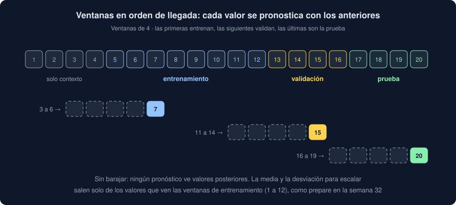

# 05 · Pronosticar en tu Observatorio

⏱️ 45 min

## 🎯 Objetivos

- Plantear un pronóstico con tu serie: cada valor a partir de los anteriores, en orden de llegada.
- Repartir las ventanas por tiempo y escalar sin mirar el futuro.
- Entender qué hace `core/convolution.py`: ventanas, red, entrenamiento con parada temprana, pronóstico, guardar y cargar.
- Leer la salida de `pronosticar` con los datos de ejemplo, y transferir una red de todas las etiquetas a una sola.

---

## 1. Otra pregunta para tus datos

`red` (semana 34) preguntaba: ¿la etiqueta y la posición dicen el valor? Con los datos de ejemplo, no. `pronosticar` hace otra pregunta: **¿los últimos valores dicen el siguiente?** Si tu dominio tiene inercia (una temperatura no salta de 10 a 40 en una medida) o ciclos (el tráfico de cada mañana), la respuesta puede ser sí aunque la etiqueta no diga nada.

El orden es el de llegada: por carga y por posición. `validation.ordered` (semana 32) ya lo hace, y además quita las medidas sin valor:

```python
import numpy as np
import pandas as pd

frame = pd.DataFrame(
    {"carga": [2, 1, 1, 2], "posicion": [0, 1, 0, 1], "valor": [30.0, 20.0, 10.0, None]}
)
print(frame.dropna(subset=["valor"]).sort_values(["carga", "posicion"], kind="stable")["valor"].tolist())
```

```
[10.0, 20.0, 30.0]
```

Sin la medida que falta, la serie es 10, 20, 30: una medida sin valor desaparece, y la ventana salta por encima de ella. Si en tu dominio faltan muchas seguidas, una ventana puede juntar valores muy separados en el tiempo; tenlo en cuenta al leer el resultado.

## 2. Ventanas, y un reparto por tiempo

Con `n` valores y ventanas de `w`, salen `n − w` ventanas (teoría 02, sección 4). Se reparten **en orden**: las primeras para entrenar, las siguientes para validar y las últimas para la prueba.



```python
values = np.arange(1, 1895, dtype=float)
window = 8
total = len(values) - window
train_end, validation_end = int(total * 0.7), int(total * 0.85)
print(total, train_end, validation_end - train_end, total - validation_end)
```

```
1886 1320 283 283
```

Son los números de los datos de ejemplo: 1894 medidas con valor, 1886 ventanas, 1320 para entrenar, 283 para validar y 283 de prueba.

¿Por qué no al azar, como `split` en la semana 31? Porque una ventana de prueba sería, por ejemplo, la de las medidas 500 a 508, y las de 499 a 507 y 501 a 509 estarían en el entrenamiento: la red habría visto casi la misma ventana, y también lo que viene después. Medirías una red que no tendrás nunca, porque en la realidad el futuro no está en el entrenamiento. Es el `TimeSeriesSplit` de la semana 32, en versión de un solo corte.

## 3. Escalar sin mirar el futuro

Como en `red`, el valor se escala: menos la media, entre la desviación típica. Pero ¿la media de qué? Solo de los valores que ven las ventanas de entrenamiento: `values[: train_end + window]`. Con la media de toda la serie, una tendencia que sube en la parte de prueba se colaría en el entrenamiento.

```python
trend = np.linspace(0, 100, 200)
total = len(trend) - window
train_end = int(total * 0.7)
seen = trend[: train_end + window]
print(f"media de lo visto {seen.mean():.1f} · media de toda la serie {trend.mean():.1f}")
```

```
media de lo visto 35.4 · media de toda la serie 50.0
```

La **referencia** predice siempre esa media, la del entrenamiento, como en `red`. Su MAE en prueba es la distancia media de cada valor de prueba a ella.

## 4. Qué hace `core/convolution.py`

| Pieza | Qué hace | Teoría |
|---|---|---|
| `windows(values, size)` | Las ventanas con forma `(n, 1, size)` y el siguiente valor con forma `(n, 1)` | 02, sección 4 |
| `cnn(size)` | `Conv1d(1, 4, 3)`, ReLU, `Flatten` y `Linear`: 41 parámetros con ventanas de 8 | 02, sección 4 |
| `freeze(model)` | Congela la capa convolucional | 04, sección 2 |
| `count(model, trainable)` | Cuántos parámetros, o cuántos entrenables | 04, sección 2 |
| `fit(model, train, validation, epochs, patience)` | Lotes de 32, Adam a 0,01, validación tras cada época, parada temprana y la mejor época | 03, secciones 2 y 6 |
| `forecast(frame, ...)` | Ordena, filtra la etiqueta, corta, reparte, escala, entrena y mide en prueba frente a la referencia | Esta teoría |
| `save` y `load` | Los pesos y la ventana, con `weights_only=True` al cargar | 03, sección 7 |

`Forecast` guarda los parámetros, los entrenables, el tamaño de cada parte, la pérdida de validación de cada época, la mejor, y el MAE de la red y de la referencia. `improves`, como en `Training`: empatar no es mejorar.

## 5. El comando `pronosticar`

```bash
uv run observatorio pronosticar notebooks/instantanea.csv
```

```
instantanea.csv: 2000 medidas · sha256: 3193779438eecdede9910a3cbc922f05a883e69a8a92fd4ef9a33e482d636c65
serie de todas las etiquetas · ventanas de 8 valores · 1320 para entrenar, 283 para validar, 283 para prueba
red convolucional, desde cero · 41 parámetros, 41 entrenables
Pérdida en validación (MSE del valor escalado)
┏━━━━━━━┳━━━━━━━━━┓
┃ Época ┃ Pérdida ┃
┡━━━━━━━╇━━━━━━━━━┩
│     1 │  0.9423 │
│     4 │  0.9515 │
│     7 │  0.9582 │
│    10 │  0.9716 │
│    13 │  0.9897 │
└───────┴─────────┘
paró en la época 13; se queda con la 3, pérdida 0.9417
pronóstico del siguiente valor · MAE en prueba: red 19.216 · referencia 19.140: la red no mejora la referencia
```

- La pérdida de validación **sube** desde la primera época: lo que aprende del entrenamiento no sirve para la validación. Tras 10 épocas sin mejorar la de la época 3, para, y se queda con esa.
- En prueba, la red se equivoca algo más que la referencia: los valores de ejemplo son independientes unos de otros, y los anteriores no dicen nada del siguiente. Es lo mismo que dijeron `red`, `competir` y los hallazgos, con otra pregunta.
- La tabla enseña como mucho seis épocas: la primera, unas repartidas y la última. La mejor puede no estar; por eso va en la línea siguiente.

Para una sola etiqueta, y para transferir:

```bash
uv run observatorio pronosticar notebooks/instantanea.csv --guardar pesos.pt
uv run observatorio pronosticar notebooks/instantanea.csv --etiqueta Sur
uv run observatorio pronosticar notebooks/instantanea.csv --etiqueta Sur --desde pesos.pt
```

```
...
pesos guardados en pesos.pt
...
serie de Sur · ventanas de 8 valores · 243 para entrenar, 52 para validar, 53 para prueba
red convolucional, desde cero · 41 parámetros, 41 entrenables
...
pronóstico del siguiente valor · MAE en prueba: red 18.151 · referencia 18.104: la red no mejora la referencia
...
red convolucional, filtros congelados de pesos.pt · 41 parámetros, 25 entrenables
...
pronóstico del siguiente valor · MAE en prueba: red 17.948 · referencia 18.104: la red mejora la referencia
```

- Sur tiene 374 medidas, 356 con valor: 348 ventanas, 53 de prueba.
- Con `--desde`, la red empieza con los filtros entrenados con todas las etiquetas, congelados, y solo entrena la salida: 25 parámetros. La ventana es la de los pesos: sus capas tienen ese tamaño.
- "La red mejora la referencia", por 0,16. **No te lo creas todavía**: `--etiqueta Sur --semilla 7` desde cero da 17,889, también "mejora", y con `--desde` y `--semilla 7`, 18,031. Con 53 valores de prueba y un solo corte, unas décimas son ruido. Para afirmar que mejora harían falta varios cortes, como `TimeSeriesSplit` en `ajustar --tiempo` (semana 32), y datos con algo que aprender.

## 6. ¿Y con tus datos?

Si tu dominio tiene inercia o ciclos, `pronosticar` debería ganar a la referencia por mucho, no por décimas: en los tests del bootcamp, una onda que se repite cada 12 medidas baja el MAE a menos de un tercio del de la referencia. Si no gana, no es un fallo del código: tus valores no dependen de los anteriores, o los separan medidas que faltan, o la ventana es demasiado corta para el ciclo. Prueba `--ventana 24` si sospechas un ciclo diario con medidas por hora.

## ⚠️ Errores comunes

| Error | Consecuencia | Mejor |
|---|---|---|
| Barajar las ventanas antes de repartir | La prueba se parece al entrenamiento: un MAE que nunca tendrás | Repartir en orden; barajar solo dentro del entrenamiento, por lotes |
| Escalar con la media de toda la serie | El futuro se cuela en el entrenamiento | La media y la desviación de `values[: train_end + window]` |
| Leer "mejora" con un solo corte y una diferencia de décimas | Conclusiones que cambian con la semilla | Otra semilla, otra etiqueta, y varios cortes antes de decir nada |
| Usar `--desde` con pesos de otra ventana y esperar la tuya | La ventana es la de los pesos | Mira la línea "ventanas de N valores" |
| Cargar unos pesos que no has guardado tú con `weights_only=False` | Ejecuta lo que traiga el archivo | `load` usa `weights_only=True`: un archivo con otra cosa da código 2 |

## ✅ Qué debes saber al terminar

- Qué pregunta hace `pronosticar` y en qué se diferencia de la de `red`.
- Por qué las ventanas se reparten por tiempo y el escalado sale solo de lo que ve el entrenamiento.
- Qué hace cada función de `core/convolution.py`.
- Leer la salida: la pérdida de validación, dónde paró, la mejor época y el veredicto.
- Por qué "mejora" por unas décimas, con un solo corte, no significa nada.

---

## 🔗 Navegación

| Anterior | Actual | Siguiente |
| -------- | ------ | --------- |
| [04 · Transfer learning](04-transfer-learning.md) | **05 · Pronosticar en tu Observatorio** | [Ejercicio 01 · La convolución](../2-practicas/ejercicio-01-la-convolucion/README.md) |
