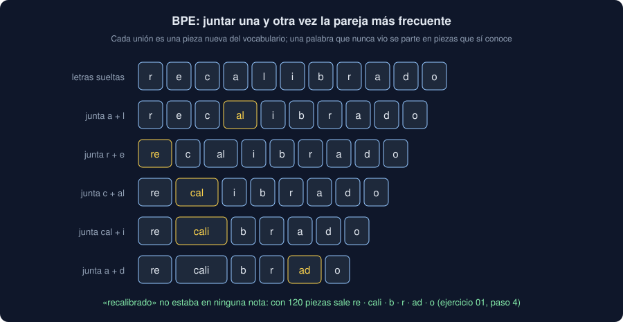

# 01 · Del texto a números

⏱️ 45 min

## 🎯 Objetivos

- Entender por qué un modelo no puede leer texto y qué significa convertirlo en números.
- Construir una bolsa de palabras y TF-IDF, y saber qué pierden.
- Tokenizar en subpalabras con BPE, y reconocer WordPiece y SentencePiece.
- Preparar un lote: identificadores, piezas especiales, relleno, corte y máscara de atención.

---

## 1. El texto libre de tu dominio

Hasta ahora tu Observatorio solo tenía números: una etiqueta y un valor. Pero en casi todos los dominios hay también **texto libre**: notas de mantenimiento, comentarios de clientes, observaciones de un técnico (`docs/dominios.md`, columna "Texto libre"). Nadie lo lee entero, y ahí suele estar lo que explica los números: por qué una estación marcó cero toda la mañana.

**NLP** (*Natural Language Processing*, procesamiento del lenguaje natural) es convertir ese texto en algo que un programa pueda contar, comparar o clasificar. Esta semana la tarea es una: **clasificar** cada nota en un tipo (avería, limpieza, calibración), como la regresión logística de la semana 31 clasificaba medidas.

El problema de fondo: un modelo solo hace cuentas con números, y una nota es una secuencia de caracteres de longitud variable. Todo NLP empieza por decidir cómo convertirla.

## 2. Una bolsa de palabras

La forma más antigua: contar cuántas veces sale cada palabra, sin importar dónde.

```python
from sklearn.feature_extraction.text import CountVectorizer

notes = [
    "se limpió el filtro",
    "el sensor no responde",
    "se cambió el filtro sucio",
]
counter = CountVectorizer()
matrix = counter.fit_transform(notes)
print(counter.get_feature_names_out())
print(matrix.toarray())
```

```
['cambió' 'el' 'filtro' 'limpió' 'no' 'responde' 'se' 'sensor' 'sucio']
[[0 1 1 1 0 0 1 0 0]
 [0 1 0 0 1 1 0 1 0]
 [1 1 1 0 0 0 1 0 1]]
```

- **`fit`** aprende el **vocabulario**: las 9 palabras distintas, en orden alfabético.
- **`transform`** convierte cada nota en 9 números: cuántas veces sale cada palabra del vocabulario.

El resultado es una tabla como las de las semanas 31 a 33: una fila por nota, una columna por palabra. Ya se le puede dar a una regresión logística. Con miles de notas, el vocabulario tiene decenas de miles de palabras y casi todos los números son 0: scikit-learn guarda la tabla **dispersa** (solo lo que no es 0), y `toarray()` la convierte en una normal para verla.

## 3. TF-IDF: no todas las palabras pesan igual

"el" sale en las tres notas: no ayuda a distinguirlas. **TF-IDF** multiplica la frecuencia de la palabra en la nota (*term frequency*) por lo rara que es en todas las notas (*inverse document frequency*), y normaliza cada fila:

```python
from sklearn.feature_extraction.text import TfidfVectorizer

tfidf = TfidfVectorizer()
weights = tfidf.fit_transform(notes).toarray()
for word, weight in zip(tfidf.get_feature_names_out(), weights[2], strict=True):
    if weight:
        print(f"{word:>7} {weight:.2f}")
```

```
 cambió 0.53
     el 0.32
 filtro 0.41
     se 0.41
  sucio 0.53
```

En la tercera nota, "cambió" y "sucio" (solo salen ahí) pesan más que "filtro" y "se" (salen en dos), y "el" (en las tres) es lo que menos.

TF-IDF con una regresión logística es la **referencia** de NLP: rápido, sin GPU, fácil de explicar, y sorprendentemente bueno cuando las notas usan palabras parecidas para lo mismo. En el proyecto, `clasificar` lo entrena siempre junto al Transformer: si un modelo de miles de parámetros no gana a TF-IDF, no compensa.

## 4. Lo que una bolsa no ve

Dos límites que ningún ajuste arregla:

```python
pair = ["se limpió el filtro, no el sensor", "se limpió el sensor, no el filtro"]
both = CountVectorizer().fit(pair).transform(pair).toarray()
print((both[0] == both[1]).all())
print(counter.transform(["se recalibró el filtro"]).toarray())
```

```
True
[[0 1 1 0 0 0 1 0 0]]
```

- **El orden no existe.** Las dos notas dicen lo contrario y dan el mismo vector.
- **Lo que no estaba al ajustar no existe.** "recalibró" no estaba en las tres notas: desaparece sin avisar. Y "recalibrado", "recalibración" o "recalibro" (sin tilde) serían tres palabras distintas, cada una sin relación con las otras.

En tus notas reales, los técnicos escriben con faltas, abreviaturas y sinónimos: el segundo límite es el que más duele.

## 5. Subpalabras con BPE

La solución de los Transformers es partir el texto en **piezas** (*tokens*) más pequeñas que una palabra. **BPE** (*Byte Pair Encoding*) las aprende de un corpus:

1. Empieza con cada carácter suelto como pieza.
2. Cuenta qué pareja de piezas seguidas sale más en todo el corpus, y la junta en una pieza nueva.
3. Repite hasta tener el número de piezas pedido.



La biblioteca `tokenizers` de Hugging Face lo hace en Rust, rápido:

```python
from tokenizers import Tokenizer, normalizers, pre_tokenizers
from tokenizers.models import BPE
from tokenizers.trainers import BpeTrainer

corpus = [
    "se recalibró el sensor de Norte",
    "el sensor de Sur se recalibró con el patrón",
    "se limpió el filtro del sensor",
    "el filtro estaba sucio",
] * 10
model = Tokenizer(BPE(unk_token="[UNK]"))
model.normalizer = normalizers.Sequence(
    [normalizers.NFD(), normalizers.StripAccents(), normalizers.Lowercase()]
)
model.pre_tokenizer = pre_tokenizers.Whitespace()
trainer = BpeTrainer(vocab_size=60, special_tokens=["[PAD]", "[UNK]"], show_progress=False)
model.train_from_iterator(corpus, trainer)
# 59, no 60: con este corpus no hay más parejas que juntar.
print(model.get_vocab_size())
for text in ["Recalibró", "recalibrado", "sensores", "ozono"]:
    print(f"{text:>12} → {model.encode(text).tokens}")
```

```
59
   Recalibró → ['recalibro']
 recalibrado → ['recali', 'b', 'r', 'a', 'd', 'o']
    sensores → ['sensor', 'es']
       ozono → ['o', '[UNK]', 'o', 'n', 'o']
```

- El **normalizador** quita tildes (`NFD` separa la tilde de la letra, `StripAccents` la borra) y pasa a minúsculas: "Recalibró" y "recalibro" dan lo mismo.
- El **pre-tokenizador** `Whitespace` separa antes por espacios y signos: ninguna pieza cruza dos palabras.
- Las palabras frecuentes acaban siendo una sola pieza ("recalibro"); las nuevas se parten en piezas conocidas ("recali" + "b" + "r" + "a" + "d" + "o"). "sensores" no estaba, pero "sensor" sí: la relación se conserva.
- "ozono" tiene una "z" que no salió nunca en el corpus: `[UNK]`, la pieza para lo desconocido. Con un corpus de verdad pasa poco, pero pasa.

`[PAD]` y `[UNK]` son **piezas especiales**: las primeras del vocabulario (0 y 1). Tu `language.tokenizer` del proyecto es exactamente este código, entrenado con tus notas.

## 6. WordPiece, SentencePiece y los tokenizadores preentrenados

Los modelos preentrenados traen su propio tokenizador, entrenado con el mismo corpus enorme que el modelo. Dos familias (ejercicio 01, pasos 5 y 6):

| | WordPiece (BERT) | SentencePiece (XLM-R, MiniLM multilingüe, Llama) |
|---|---|---|
| Cómo aprende | Como BPE, pero junta la pareja que más mejora la probabilidad del corpus | BPE o *Unigram*, sobre el texto con los espacios dentro |
| Marca | `##` en la pieza que **continúa** una palabra: `analiza ##dor` | `▁` en la pieza que **empieza** una palabra: `▁analiza dor` |
| Piezas especiales | `[CLS]`, `[SEP]`, `[PAD]`, `[UNK]`, `[MASK]` | `<s>`, `</s>`, `<pad>`, `<unk>`, `<mask>` |

Lo importante no es la familia, sino la regla: **un modelo solo entiende las piezas de su tokenizador**. Si cambias de modelo, cambias de tokenizador; `AutoTokenizer.from_pretrained(nombre)` carga el que va con cada modelo (teoría 04).

## 7. Un lote: relleno, corte y máscara

Un tensor necesita filas de la misma longitud, y las notas no la tienen:

```python
model.enable_padding(pad_id=0, pad_token="[PAD]", length=8)
model.enable_truncation(8)
for encoding in model.encode_batch(["filtro sucio", "se recalibró el sensor de Norte con el patrón"]):
    print(encoding.tokens)
    print(encoding.ids, encoding.attention_mask)
```

```
['filtro', 'sucio', '[PAD]', '[PAD]', '[PAD]', '[PAD]', '[PAD]', '[PAD]']
[37, 52, 0, 0, 0, 0, 0, 0] [1, 1, 0, 0, 0, 0, 0, 0]
['se', 'recalibro', 'el', 'sensor', 'de', 'norte', 'con', 'el']
[19, 38, 18, 26, 30, 55, 53, 18] [1, 1, 1, 1, 1, 1, 1, 1]
```

- **Relleno** (*padding*): la nota corta se completa con `[PAD]` (id 0) hasta 8 piezas.
- **Corte** (*truncation*): la larga se queda en 8; "patrón" se pierde. Elige la longitud mirando tus notas: en el proyecto, `LENGTH = 48`.
- **Máscara de atención** (*attention mask*): 1 en las piezas de verdad, 0 en el relleno. El modelo la usa para no mirar el relleno (teoría 02, sección 5). Tu `Encoder` no la recibe aparte: la calcula como `ids == 0`, porque `[PAD]` es siempre el 0.

## ⚠️ Errores comunes

| Error | Consecuencia | Mejor |
|---|---|---|
| Entrenar el tokenizador (o TF-IDF) con todas las notas, también las de prueba | Las palabras de prueba ya son piezas conocidas: un acierto que no tendrás con notas nuevas | Ajustarlo solo con las de entrenamiento (teoría 05) |
| Usar el tokenizador de un modelo con otro modelo | Identificadores que no significan nada para el modelo, sin ningún error | `AutoTokenizer` y `AutoModel` con el mismo nombre y la misma `revision` |
| No mirar cuántas piezas tiene una nota | El corte se come el final, justo donde dice "se pidió un repuesto" | Medir la longitud en piezas de tus notas antes de elegir `LENGTH` |
| Olvidar el normalizador | "Calibración" y "calibracion" son piezas distintas | `NFD`, `StripAccents` y `Lowercase`, o un modelo *cased* a propósito |
| Pensar que TF-IDF está pasado de moda | Un modelo grande que no mejora la referencia, y nadie lo mide | Entrenar siempre TF-IDF al lado y comparar en la misma prueba |

## ✅ Qué debes saber al terminar

- Construir una bolsa de palabras y TF-IDF, y explicar los pesos de una nota.
- Los dos límites de una bolsa: el orden y las palabras nuevas.
- Cómo aprende BPE sus piezas, y qué hacen el normalizador y el pre-tokenizador.
- Reconocer WordPiece (`##`) y SentencePiece (`▁`), y por qué cada modelo lleva su tokenizador.
- Qué son el relleno, el corte, las piezas especiales y la máscara de atención.

---

## 🔗 Navegación

| Anterior | Actual | Siguiente |
| -------- | ------ | --------- |
| [Semana 36](../README.md) | **01 · Del texto a números** | [02 · Embeddings y atención](02-embeddings-y-atencion.md) |
