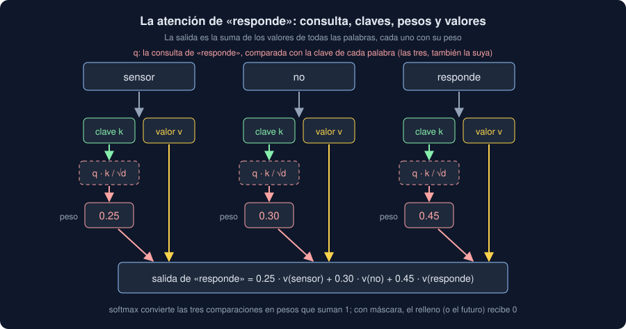

# 02 · Embeddings y atención

⏱️ 50 min

## 🎯 Objetivos

- Convertir piezas en vectores con `nn.Embedding` y medir su parecido.
- Calcular la atención a mano: productos escalares, `softmax` y una media con pesos.
- Distinguir consultas, claves y valores, y usar `F.scaled_dot_product_attention`.
- Aplicar las dos máscaras (relleno y futuro) y entender las cabezas de `nn.MultiheadAttention`.

---

## 1. De piezas a vectores

El tokenizador convierte una nota en identificadores: `[19, 38, 18, 26]`. Esos números son posiciones en una lista, no cantidades: la pieza 38 no es "el doble" que la 19. Lo primero que hace un modelo es cambiar cada identificador por un **vector** que se aprende:

```python
import math

import torch
import torch.nn.functional as F
from torch import nn

torch.manual_seed(0)
table = nn.Embedding(num_embeddings=6, embedding_dim=4, padding_idx=0)
ids = torch.tensor([[3, 5, 1, 0, 0]])
vectors = table(ids)
print(table.weight.shape, ids.shape, vectors.shape)
print(vectors[0, 3:].tolist())
```

```
torch.Size([6, 4]) torch.Size([1, 5]) torch.Size([1, 5, 4])
[[0.0, 0.0, 0.0, 0.0], [0.0, 0.0, 0.0, 0.0]]
```

- **`nn.Embedding(6, 4)`** es una tabla de 6 filas (una por pieza del vocabulario) y 4 columnas. Buscar la pieza 3 es tomar la fila 3: no hay multiplicaciones.
- La forma pasa de `(notas, piezas)` a `(notas, piezas, 4)`: cada pieza es ahora un vector.
- **`padding_idx=0`**: la fila del relleno es siempre 0 y no se entrena. Un vector de ceros no aporta nada a una suma.

La tabla empieza al azar, como los pesos de la semana 34. El entrenamiento la mueve: las piezas que ayudan a predecir lo mismo acaban con vectores parecidos. A esos vectores se les llama ***embeddings***.

## 2. Vectores que se parecen

El parecido entre dos vectores se mide con su **producto escalar**: multiplicar número a número y sumar. Dividido por sus longitudes, es la **similitud coseno**: 1 si apuntan al mismo lado, 0 si no tienen nada que ver, −1 si son opuestos.

```python
# Dos números hechos a mano: "cuánto de limpieza" y "cuánto de avería".
words = ["filtro", "polvo", "sensor", "responde"]
X = torch.tensor([[1.0, 0.1], [0.9, 0.2], [0.2, 0.8], [0.1, 1.0]])
similar = F.cosine_similarity(X[0], X[1], dim=0).item()
different = F.cosine_similarity(X[0], X[3], dim=0).item()
print(f"filtro y polvo {similar:.2f} · filtro y responde {different:.2f}")
```

```
filtro y polvo 0.99 · filtro y responde 0.20
```

"filtro" y "polvo" casi coinciden; "filtro" y "responde", poco. En un modelo de verdad, los vectores tienen cientos de números, ninguno con un significado tan claro, pero la idea es la misma: el ejercicio 03 encuentra "La estación no transmite mediciones" a partir de "El equipo no da datos" sin una palabra en común.

## 3. La atención: cada pieza se mezcla con las demás

Un embedding es el mismo vector para "no" en "no responde" que en "sin avería, no hizo falta calibrar". Pero lo que significa depende de las demás piezas. La **atención** (*self-attention*) cambia cada vector por una media de **todos** los vectores de la nota, con más peso para los que más se le parecen:

```python
scores = X @ X.T / math.sqrt(X.shape[1])
weights = scores.softmax(dim=1)
mixed = weights @ X
print(weights.round(decimals=2))
print(mixed[3].round(decimals=2))
```

```
tensor([[0.3200, 0.3000, 0.1900, 0.1800],
        [0.3100, 0.2900, 0.2000, 0.2000],
        [0.2100, 0.2200, 0.2700, 0.3000],
        [0.1900, 0.2000, 0.2900, 0.3300]])
tensor([0.4500, 0.6200])
```

Tres pasos:

1. **`X @ X.T`**: el producto escalar de cada pieza con todas, una tabla de 4 × 4.
2. **`/ math.sqrt(2)`**: dividir por la raíz del tamaño del vector. Con vectores de 384 números, los productos escalares serían enormes y `softmax` daría casi todo el peso a una sola pieza.
3. **`softmax(dim=1)`**: cada fila se convierte en pesos positivos que suman 1.

La salida de "responde" es un 33 % de sí misma, un 29 % de "sensor" y algo menos de las otras dos: un vector que ya sabe en qué nota está. Ninguna pieza queda fuera: la primera mira a la última tan fácil como a la de al lado. Las redes anteriores (recurrentes) leían el texto pieza a pieza y olvidaban el principio de las notas largas.

## 4. Consultas, claves y valores

En la sección 3, cada pieza usaba el mismo vector para tres papeles. La atención de un Transformer los separa con tres capas lineales que se aprenden:

- la **consulta** (*query*): qué busca esta pieza;
- la **clave** (*key*): qué ofrece a las que buscan;
- el **valor** (*value*): qué aporta si la eligen.



```python
torch.manual_seed(0)
query, key, value = nn.Linear(2, 4), nn.Linear(2, 4), nn.Linear(2, 4)
with torch.no_grad():
    q, k, v = query(X), key(X), value(X)
    by_hand = (q @ k.T / math.sqrt(4)).softmax(dim=1) @ v
    fused = F.scaled_dot_product_attention(q, k, v)
print(q.shape, by_hand.shape, torch.allclose(by_hand, fused, atol=1e-6))
```

```
torch.Size([4, 4]) torch.Size([4, 4]) True
```

En una línea: **atención(Q, K, V) = softmax(Q · Kᵀ / √d) · V**, con `d` el tamaño de las consultas y las claves.

`F.scaled_dot_product_attention` hace la misma cuenta en una sola operación, más rápida y con menos memoria. La consulta de "responde" puede aprender a buscar "qué equipo", y la clave de "sensor", a ofrecerlo: el modelo decide qué relaciones importan.

## 5. Dos máscaras

Una **máscara** pone `-inf` en las puntuaciones que no se pueden mirar, antes de `softmax`. `exp(-inf)` es 0: esas piezas reciben peso 0 exacto, y el resto se reparte entre las demás.

```python
padding = torch.tensor([False, False, True, True])
print(scores.masked_fill(padding, float("-inf")).softmax(dim=1)[0].round(decimals=2))
future = torch.ones(4, 4, dtype=torch.bool).triu(diagonal=1)
print(scores.masked_fill(future, float("-inf")).softmax(dim=1).round(decimals=2))
```

```
tensor([0.5200, 0.4800, 0.0000, 0.0000])
tensor([[1.0000, 0.0000, 0.0000, 0.0000],
        [0.5100, 0.4900, 0.0000, 0.0000],
        [0.3000, 0.3100, 0.3900, 0.0000],
        [0.1900, 0.2000, 0.2900, 0.3300]])
```

- **La del relleno**: las dos últimas piezas son `[PAD]`. Sin máscara, el resultado de una nota dependería de lo larga que fuera la más larga de su lote. En PyTorch, `src_key_padding_mask` en un `nn.TransformerEncoder`; en Hugging Face, `attention_mask` (teoría 01, sección 7).
- **La del futuro** (*causal*): cada pieza solo mira a las anteriores. Es la de los modelos que **generan** texto, pieza a pieza: no pueden mirar lo que aún no han escrito. Los que **leen** la nota entera para clasificarla (BERT, tu `Encoder`) no la usan.

## 6. Varias cabezas

Una sola atención mezcla según un único criterio. **`nn.MultiheadAttention`** hace varias a la vez (*cabezas*), cada una con su propia consulta, clave y valor sobre una parte del vector, y junta los resultados con una capa lineal más:

```python
attention = nn.MultiheadAttention(embed_dim=16, num_heads=2, batch_first=True)
batch = torch.randn(3, 5, 16)
output, heads = attention(batch, batch, batch, average_attn_weights=False)
print(output.shape, heads.shape)
print(sum(p.numel() for p in attention.parameters()))
```

```
torch.Size([3, 5, 16]) torch.Size([3, 2, 5, 5])
1088
```

- **La salida tiene la forma de la entrada**: `(lote, piezas, 16)`. Por eso se pueden apilar capas, una sobre otra.
- **Los pesos**: una tabla de piezas × piezas por cabeza: `(3, 2, 5, 5)`.
- **1088 parámetros**: consulta, clave, valor y salida, cuatro matrices de 16 × 16 con sus sesgos. Con 16 números y 2 cabezas, cada cabeza trabaja con 8.

Es la atención de tu `Encoder`. El modelo multilingüe de los ejercicios tiene 12 capas de 12 cabezas sobre vectores de 384: 144 tablas de pesos por nota (ejercicio 02, paso 8).

## ⚠️ Errores comunes

| Error | Consecuencia | Mejor |
|---|---|---|
| Aplicar la máscara después de `softmax` | Los pesos ya no suman 1 y el relleno ha influido | `masked_fill(..., -inf)` antes de `softmax` |
| Olvidar la máscara del relleno | El resultado de una nota cambia según su lote | `src_key_padding_mask` o `attention_mask` siempre que haya relleno |
| Usar la máscara causal para clasificar | Cada pieza ignora lo que viene después: se pierde la mitad de la nota | Causal solo para generar texto |
| No dividir por `√d` | Con vectores grandes, `softmax` se satura y los gradientes se apagan | `scaled_dot_product_attention` ya lo hace |
| Leer una tabla de atención como una explicación | Conclusiones sobre una cabeza entre 144 | Mirar los pesos ayuda a entender; para explicar, hace falta medir |

## ✅ Qué debes saber al terminar

- Qué hace `nn.Embedding` y por qué el relleno tiene un vector de ceros.
- Calcular la atención a mano: `softmax(q @ k.T / √d) @ v`.
- Qué papel tienen la consulta, la clave y el valor.
- Qué hace cada máscara, y cuándo se usa la causal.
- Por qué la salida de la atención tiene la forma de su entrada, y qué es una cabeza.

---

## 🔗 Navegación

| Anterior | Actual | Siguiente |
| -------- | ------ | --------- |
| [01 · Del texto a números](01-del-texto-a-numeros.md) | **02 · Embeddings y atención** | [03 · El Transformer](03-el-transformer.md) |
