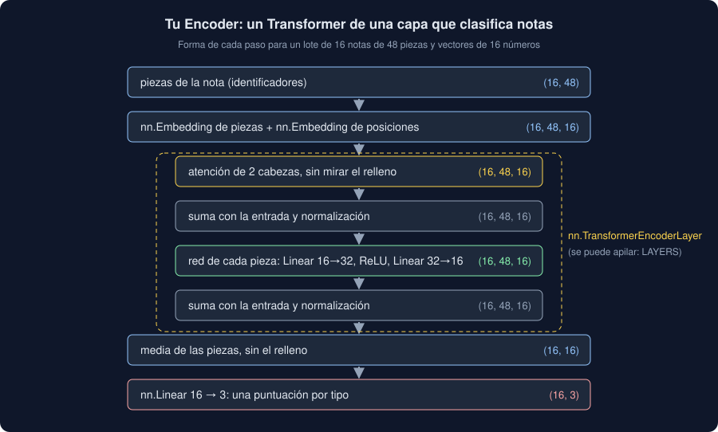

# 03 · El Transformer

⏱️ 50 min

## 🎯 Objetivos

- Reconocer las piezas de un bloque Transformer: atención, red de cada pieza, sumas y normalizaciones.
- Entender por qué hacen falta las posiciones y cómo se añaden.
- Seguir la forma de un lote por tu `Encoder` y contar sus parámetros.
- Distinguir los modelos que leen (BERT) de los que generan (GPT, Claude), y qué es preentrenar.

---

## 1. Un bloque

El artículo *Attention Is All You Need* (2017) propuso un bloque que se repite, y que hoy está dentro de casi todos los modelos de lenguaje. Un bloque de los que **leen** (*encoder*) tiene cuatro partes:

1. **Atención** de varias cabezas (teoría 02): cada pieza se mezcla con las demás.
2. **Suma y normalización**: a la salida de la atención se le suma su entrada (una conexión **residual**) y se normaliza cada vector (`LayerNorm`: media 0 y desviación 1, como `StandardScaler` pero por pieza).
3. **Una red para cada pieza**: dos capas lineales con una ReLU en medio, como el MLP de la semana 34, aplicadas a cada pieza por separado. La atención mezcla; esta red procesa lo mezclado.
4. **Otra suma y normalización.**



La conexión residual es lo que permite apilar decenas de bloques: si un bloque no aporta nada, puede dejar pasar su entrada casi sin tocarla, y el gradiente llega a las primeras capas sin apagarse.

En PyTorch, el bloque entero es `nn.TransformerEncoderLayer`, y una pila de bloques, `nn.TransformerEncoder`:

```python
import torch
from torch import nn

torch.manual_seed(0)
layer = nn.TransformerEncoderLayer(
    d_model=16, nhead=2, dim_feedforward=32, dropout=0.1, batch_first=True
)
print([name for name, _ in layer.named_children()])
x = torch.randn(4, 10, 16)
print(layer.eval()(x).shape)
```

```
['self_attn', 'linear1', 'dropout', 'linear2', 'norm1', 'norm2', 'dropout1', 'dropout2']
torch.Size([4, 10, 16])
```

La atención (`self_attn`), las dos capas de la red (`linear1`, `linear2`), las dos normalizaciones y los *dropout* de la semana 35. La salida, otra vez, con la forma de la entrada.

## 2. Las posiciones

La atención es una media con pesos, y una media no sabe de orden: si desordenas las piezas, cada una recibe exactamente lo mismo, solo que en otro sitio. El bloque entero tampoco lo sabe:

```python
order = torch.randperm(10)
with torch.no_grad():
    print(torch.allclose(layer(x)[:, order], layer(x[:, order]), atol=1e-5))
```

```
True
```

Para el bloque, "se limpió el filtro, no el sensor" y "se limpió el sensor, no el filtro" son la misma bolsa de piezas: el problema de la teoría 01, sección 4. La solución es **sumar a cada vector otro que diga su posición**:

- el artículo original usaba senos y cosenos de distintas frecuencias, fijos (ejercicio 02, paso 6);
- BERT y tu `Encoder` usan una segunda tabla `nn.Embedding`, de posiciones, aprendida: la fila 0 para la primera pieza, la 1 para la segunda...;
- los modelos de lenguaje recientes giran las consultas y las claves según la posición (*RoPE*), y así generalizan mejor a textos más largos.

Con las posiciones sumadas, "filtro" en la posición 3 y "filtro" en la 6 son vectores distintos, y el orden cuenta.

## 3. Tu Encoder, capa a capa

`core/language.py` junta todo en una clase `nn.Module` (semana 34) con su `forward`:

```python
from observatorio.core.convolution import count
from observatorio.core.language import LENGTH, Encoder

torch.manual_seed(0)
model = Encoder(vocabulary=200, classes=3).eval()
ids = torch.randint(2, 200, (16, LENGTH))
ids[:, 20:] = 0
with torch.no_grad():
    print(model(ids).shape)
for name, part in model.named_children():
    print(f"{name:>9} {count(part):>5}")
print(f"{'total':>9} {count(model):>5}")
```

```
torch.Size([16, 3])
   tokens  3200
positions   768
  encoder  2224
   output    51
    total  6243
```

16 notas de 48 piezas (las 28 últimas, relleno) salen como 16 filas de 3 puntuaciones, una por tipo. Los parámetros:

| Parte | Cuenta | Parámetros |
|---|---|---|
| `tokens` | 200 piezas × 16 | 3200 |
| `positions` | 48 posiciones × 16 | 768 |
| `encoder` | atención 1088 + red 16 × 32 + 32 + 32 × 16 + 16 + dos normalizaciones de 2 × 16 | 2224 |
| `output` | 16 × 3 + 3 | 51 |

**Más de la mitad son las tablas**: 3968 de 6243. En el modelo multilingüe del ejercicio 04 es lo mismo, a lo grande: 96 de sus 118 millones de parámetros son la tabla de piezas: 250 037 filas de 384 números.

Al final del `forward`, la **media de las piezas sin el relleno** convierte `(16, 48, 16)` en `(16, 16)`: un vector por nota, como los embeddings de frase del ejercicio 03. BERT usa en su lugar el vector de la primera pieza, `[CLS]`, que la atención ha llenado de información de toda la nota.

## 4. Leer, generar, o las dos cosas

Con el mismo bloque se construyen tres familias:

| Familia | Atención | Entrena prediciendo | Para qué | Ejemplos |
|---|---|---|---|---|
| ***Encoder*** (lee) | Todas con todas | Piezas tapadas con `[MASK]` en medio del texto | Clasificar, buscar, embeddings | BERT, BETO, MiniLM, tu `Encoder` |
| ***Decoder*** (genera) | Causal: solo las anteriores | La pieza siguiente | Escribir texto, conversar, resumir | GPT, Llama, Claude |
| ***Encoder-decoder*** | Uno lee, el otro genera mirando lo leído | Texto de salida a partir del de entrada | Traducir | T5, el Transformer original |

Un modelo que genera escribe **una pieza cada vez**: predice la siguiente, la añade y vuelve a empezar. Con eso, y miles de millones de parámetros, se conversa: es la semana 37. Para clasificar notas, un *encoder* pequeño basta, y es mucho más barato.

## 5. Preentrenar y afinar

Un Transformer al azar no sabe nada del idioma. Los modelos del Hub se **preentrenan** con una tarea que no necesita etiquetas: tapar una pieza de cada siete y adivinarla (BERT), o adivinar la siguiente (GPT). Con miles de millones de frases, para acertar tienen que aprender gramática, sinónimos, que "mugre" y "polvo" se parecen... Todo eso queda en sus pesos.

Después se **afinan** (*fine-tuning*) con unas pocas etiquetas de tu tarea: es el *transfer learning* de la semana 35, con un modelo de origen mucho más grande. El ejercicio 04 lo hace con 30 notas.

Tu `Encoder` empieza desde cero, con 6243 parámetros y 180 notas. No puede saber que "mugre" se parece a "polvo": solo ve las palabras de tus notas. Por eso, en el proyecto, empata con TF-IDF en el mejor de los casos. No es un fallo del código: es lo que se puede aprender con 180 notas. Lo que el proyecto enseña es cómo está hecho un Transformer por dentro; los ejercicios 03 y 04, lo que aporta uno preentrenado.

## ⚠️ Errores comunes

| Error | Consecuencia | Mejor |
|---|---|---|
| Olvidar las posiciones | El modelo trata la nota como una bolsa de piezas | Sumar un `nn.Embedding` de posiciones a los de las piezas |
| `batch_first=False` (el valor por defecto) con lotes `(notas, piezas, d)` | Mezcla notas en lugar de piezas, sin ningún error | `batch_first=True` en la capa y en `nn.MultiheadAttention` |
| La media de todas las piezas, con relleno | El vector de una nota depende de su lote | Multiplicar por la máscara y dividir por las piezas de verdad |
| Entrenar desde cero con pocas notas y esperar milagros | Un modelo que no gana a TF-IDF | Preentrenado y afinado, o TF-IDF |
| Un modelo que genera para clasificar miles de notas | Lento y caro para una etiqueta de tres | Un *encoder* pequeño, afinado o con embeddings |

## ✅ Qué debes saber al terminar

- Las cuatro partes de un bloque y para qué sirve la conexión residual.
- Por qué la atención no ve el orden y tres formas de añadir las posiciones.
- La forma de un lote en cada paso de tu `Encoder`, y dónde están sus parámetros.
- Qué diferencia un *encoder* de un *decoder*, y cuál usarías para clasificar notas.
- Qué es preentrenar y afinar, y por qué tu `Encoder` desde cero no puede ganar mucho a TF-IDF.

---

## 🔗 Navegación

| Anterior | Actual | Siguiente |
| -------- | ------ | --------- |
| [02 · Embeddings y atención](02-embeddings-y-atencion.md) | **03 · El Transformer** | [04 · Hugging Face](04-hugging-face.md) |
