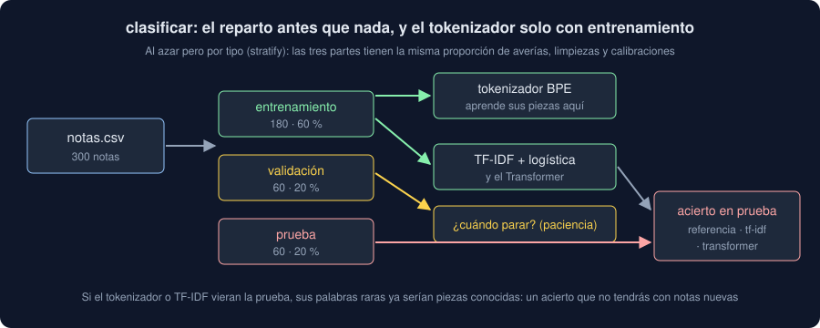

# 05 · Clasificar notas en tu Observatorio

⏱️ 45 min

## 🎯 Objetivos

- Preparar las notas de texto libre de tu dominio en `notas.csv`.
- Repartir al azar por tipo y entrenar el tokenizador sin mirar la prueba.
- Entender qué hace `core/language.py`: leer, tokenizar, el `Encoder`, comparar tres modelos y predecir.
- Leer la salida de `clasificar` con los datos de ejemplo, sin sacar más conclusiones de las que permiten 60 notas.

---

## 1. Tus notas

Tu Observatorio gana un archivo nuevo, `notas.csv`, con tres columnas separadas por `;`:

| Columna | Qué es | Ejemplo |
|---|---|---|
| `etiqueta` | La misma etiqueta de tus medidas | `Norte` |
| `tipo` | La clase que quieres predecir | `averia` |
| `texto` | La nota, tal como la escribió alguien | `El sensor de Norte no responde desde la madrugada, se pidió un repuesto.` |

Si tu dominio tiene notas reales etiquetadas, úsalas. Si no, `scripts/generar_notas.py` las genera: elige al azar un comienzo, lo que se hizo y un cierre de cada tipo; a un 30 % les añade una pista de otro tipo ("tras la limpieza" en una calibración), y un 15 % no dicen qué se hizo ("Visita a Centro, se revisó el equipo."). Cambia `LABELS`, `PIECES`, `HINTS` y `VAGUE` por las de tu dominio:

```bash
uv run python scripts/generar_notas.py 300 notas.csv
```

`read_notes` lee el archivo con `dtype=str` y `keep_default_na=False` (una nota que dice "NA" es un texto), quita los espacios de los extremos y comprueba lo que, si falla, haría fallar todo lo demás:

```python
from pathlib import Path

from observatorio.core import language

notes = language.read_notes(Path("notas.csv"))
print(len(notes), notes["tipo"].value_counts().to_dict())
print(notes["texto"].str.split().str.len().describe()[["min", "mean", "max"]].round(1).to_dict())
```

```
300 {'averia': 100, 'limpieza': 100, 'calibracion': 100}
{'min': 7.0, 'mean': 15.6, 'max': 25.0}
```

Faltan columnas, hay una nota sin texto o sin tipo, solo hay un tipo, o un tipo tiene menos de `MINIMUM` (5) notas: `ValueError` con la línea o el tipo, y `clasificar` termina con código 1. Las notas tienen entre 7 y 25 palabras: con `LENGTH = 48` piezas, casi ninguna se corta.

## 2. Un reparto al azar, por tipo

En la semana 35, el reparto era **por tiempo**: el pasado entrena y el futuro prueba, porque cada valor depende de los anteriores. Las notas no forman una serie: cada una se clasifica por lo que dice. El reparto es **al azar**, pero con la misma proporción de cada tipo en las tres partes (*estratificado*):

```python
import numpy as np
from sklearn.model_selection import train_test_split

kinds = notes["tipo"].to_numpy()
rest, test = train_test_split(np.arange(len(notes)), test_size=0.2, stratify=kinds, random_state=31)
train, validation = train_test_split(rest, test_size=0.25, stratify=kinds[rest], random_state=31)
for name, part in [("entrenamiento", train), ("validación", validation), ("prueba", test)]:
    print(f"{name:>13} {len(part)} · {notes["tipo"].iloc[part].value_counts().sort_index().to_dict()}")
```

```
entrenamiento 180 · {'averia': 60, 'calibracion': 60, 'limpieza': 60}
   validación 60 · {'averia': 20, 'calibracion': 20, 'limpieza': 20}
       prueba 60 · {'averia': 20, 'calibracion': 20, 'limpieza': 20}
```

60 % para entrenar, 20 % para validar (cuándo parar) y 20 % para la prueba. `0.25` del 80 % que queda es el 20 % del total: `VALIDATION_SHARE / (1 - TEST_SHARE)`. Sin `stratify`, con pocas notas, un tipo podría quedarse casi sin notas en la prueba.

Si en tu dominio las notas cambian con el tiempo (un técnico nuevo, un equipo nuevo), el reparto al azar es optimista: las notas de prueba se parecen a las de entrenamiento más que las del mes que viene. Anótalo en las limitaciones de tu informe.

## 3. Nada aprende de la prueba



El escalado de la semana 35 salía solo de los valores de entrenamiento. Aquí, lo mismo con tres cosas que aprenden de los datos:

- el **tokenizador BPE**: sus piezas salen de las notas de entrenamiento. Si viera las de prueba, una palabra que solo sale en prueba sería ya una pieza, y el acierto sería el de un modelo que ha visto el futuro;
- **TF-IDF**: su vocabulario y sus pesos, con `fit` sobre las notas de entrenamiento;
- el **Transformer**: entrena con las de entrenamiento, y la validación solo decide en qué época quedarse.

Un test del proyecto lo vigila: sustituye `language.tokenizer` por un espía y comprueba que recibe exactamente las notas de entrenamiento.

## 4. `core/language.py`

| Pieza | Qué hace |
|---|---|
| `read_notes(path)` | Lee y valida `notas.csv` (sección 1) |
| `tokenizer(texts, size)` | El BPE de la teoría 01: normaliza, separa por espacios y signos, aprende `size` piezas, rellena y corta a `LENGTH` |
| `encode(model, texts)` y `pieces(model, text)` | Los identificadores de un lote, y las piezas de una nota sin el relleno |
| `Encoder` | El Transformer de la teoría 03: piezas, posiciones, una capa con 2 cabezas, la media sin relleno y una salida por tipo |
| `classify(notes, size, epochs, patience, seed)` | Reparte, mide la referencia, entrena TF-IDF y el `Encoder`, y mide los tres en prueba |
| `predict(model, vocabulary, classes, texts)` | El tipo más probable de notas nuevas y su probabilidad |
| `Classification` | El resultado: tipos, reparto, piezas, parámetros, pérdidas, la mejor época y el acierto de cada modelo |

Tres decisiones que conviene entender:

- **`fit` es el de la semana 35**, con un parámetro nuevo: la función de pérdida. Por defecto, `MSELoss` (para `pronosticar`); aquí, `nn.CrossEntropyLoss()`, la de clasificar. Mini-lotes, validación tras cada época, parada temprana y la mejor época: todo igual.
- **La referencia** es el tipo más frecuente en **entrenamiento**, medido en prueba. Con tres tipos iguales, 0,333.
- **El ganador** es el de más acierto; en un empate, el primero de `accuracy` (referencia, TF-IDF, Transformer): el más simple. Para que los empates sean empates, el acierto del Transformer se calcula como aciertos entre notas, en `float` de Python: en `float32`, 52/60 es 0,86666667, más que el 0,8666... de TF-IDF, y el Transformer "ganaría" un empate.

## 5. Lo que dice con los datos de ejemplo

```python
result, model, vocabulary = language.classify(notes)
print(result.sizes, result.vocabulary, result.parameters)
print(f"{len(result.losses)} épocas, la mejor la {result.best + 1}")
print({name: round(accuracy, 3) for name, accuracy in result.accuracy.items()}, result.winner)
```

```
(180, 60, 60) 200 6243
17 épocas, la mejor la 7
{'referencia': 0.333, 'tf-idf': 0.95, 'transformer': 0.933} tf-idf
```

- TF-IDF acierta 57 de 60; el Transformer, 56. Una nota de diferencia es 0,017: con otra semilla (`--semilla 7`), los dos aciertan 52 y gana TF-IDF por el desempate.
- Ninguno pasa de 0,95: las notas vagas (un 15 %) no se pueden acertar más que por suerte. El techo está en los datos.
- El Transformer para pronto (la época 17) y se queda con la 7: con 180 notas, a partir de ahí solo memoriza.

La lectura honesta: **con estas notas, un Transformer desde cero no aporta nada sobre TF-IDF**, y cuesta 6243 parámetros y unos segundos de entrenamiento. Es lo que dijo la teoría 03, sección 5. Lo que aporta un Transformer (entender palabras que no ha visto) solo llega preentrenado: ejercicios 03 y 04.

## 6. Notas nuevas

```python
for kind, chance in language.predict(
    model, vocabulary, result.classes, ["El sensor de Norte no da datos", "Se ajustó el cero tras la limpieza"]
):
    print(kind, round(chance, 2))
```

```
averia 0.59
limpieza 0.95
```

La primera, bien pero con dudas: "no da datos" no está en ninguna nota, solo "no" y "datos" sueltos. La segunda es una **calibración** ("se ajustó el cero"), y el modelo dice limpieza con seguridad: "tras la limpieza" es justo la pista engañosa que el generador pone en algunas calibraciones, y el modelo se fija más en "limpieza" que en "se ajustó el cero". Una probabilidad alta no es una garantía.

`clasificar ... --nota "..."` hace esto desde la terminal, tantas veces como repitas la opción.

## ⚠️ Errores comunes

| Error | Consecuencia | Mejor |
|---|---|---|
| Entrenar el tokenizador con todas las notas | Un acierto que no tendrás con notas nuevas | `tokenizer(train_texts, size)`, después del reparto |
| Repartir sin `stratify` con pocas notas | Un tipo casi sin notas en prueba, y un acierto que depende de la suerte | `stratify=targets` en los dos `train_test_split` |
| Calcular el acierto con `float32` | Un empate que no lo es, y un ganador equivocado | Aciertos entre notas en `float` de Python |
| Leer "gana el Transformer" por una nota de diferencia | Conclusiones que cambian con la semilla | Otra semilla, y contar cuántas notas son la diferencia |
| Generar notas tan fáciles que todos aciertan 1,000 | Ninguna comparación dice nada | Notas vagas y pistas engañosas, como las de verdad |

## ✅ Qué debes saber al terminar

- Qué columnas tiene `notas.csv` y qué comprueba `read_notes`.
- Por qué el reparto es al azar por tipo, y no por tiempo como en la semana 35.
- Qué tres cosas aprenden solo de las notas de entrenamiento, y qué pasaría si no.
- Qué hace cada función de `core/language.py`, y cómo se decide el ganador.
- Leer la salida de `clasificar`, y por qué una nota de diferencia no significa nada.

---

## 🔗 Navegación

| Anterior | Actual | Siguiente |
| -------- | ------ | --------- |
| [04 · Hugging Face](04-hugging-face.md) | **05 · Clasificar notas en tu Observatorio** | [Ejercicio 01 · Del texto a números](../2-practicas/ejercicio-01-del-texto-a-numeros/README.md) |
