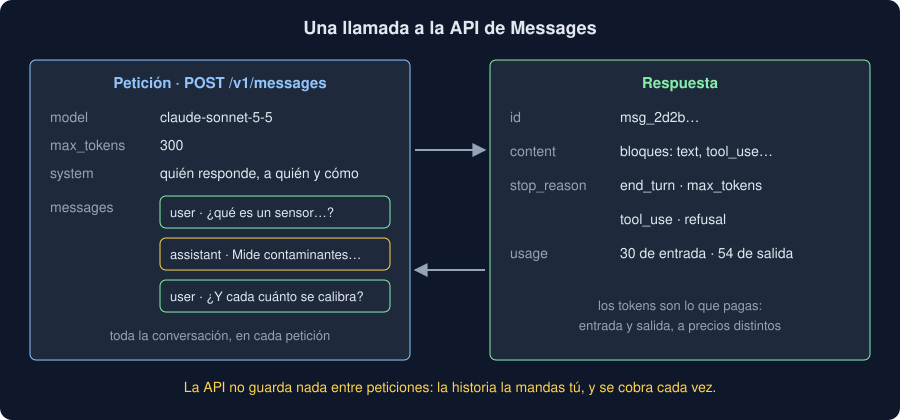

# 01 · Qué es un LLM y la API de Messages

⏱️ 45 min

## 🎯 Objetivos

- Entender qué hace un modelo de lenguaje grande (LLM) y qué no hace.
- Contar tokens y entender la ventana de contexto.
- Conocer la petición y la respuesta de la API de Messages de Anthropic.
- Elegir un modelo por lo que cuesta y por lo que necesitas.
- Guardar la clave como un secreto y tratar los errores de la API.

---

## 1. Un Transformer que escribe

En la semana 36 viste dos familias de Transformer: los *encoders*, que leen el texto entero (BERT, tu `Encoder`), y los *decoders*, que lo **escriben** pieza a pieza, con una máscara causal. Un LLM como Claude es un *decoder* enorme:

1. **Preentrenado** con muchísimo texto a predecir la pieza siguiente. Así aprende el idioma, hechos del mundo y a razonar sobre lo que lee.
2. **Ajustado** después para seguir instrucciones, conversar y negarse a lo que no debe hacer.

Al responder, repite un paso: mira todo lo que hay (tu pregunta y lo que ya ha escrito), elige la pieza siguiente, la añade y vuelve a empezar, hasta que decide terminar o se queda sin espacio.

Dos consecuencias para tu código:

- **No consulta una base de datos.** Lo que "sabe" lo aprendió al entrenar, y puede escribir con toda seguridad algo falso (*alucinación*). Los datos de tu Observatorio no los tiene: se los das en el prompt (teoría 02) o con herramientas (teoría 04).
- **No responde dos veces igual.** Al elegir cada pieza hay algo de azar: la misma petición puede dar otra respuesta. Por eso un prompt se **mide** con muchas notas, no se prueba con una.

## 2. Tokens y contexto

El modelo no lee letras ni palabras: lee **tokens**, las piezas de un tokenizador como el BPE de la semana 36. En español, una palabra corriente suele ser uno o dos tokens; un nombre raro o un número largo, varios.

Los tokens importan por tres razones:

| Qué | Por qué |
|---|---|
| **Lo que pagas** | El precio va por millón de tokens de entrada y de salida |
| **La ventana de contexto** | Lo máximo que cabe en una petición: lo que envías más lo que escribe. Sonnet 5.5, un millón de tokens |
| **`max_tokens`** | El máximo que puede escribir en esta respuesta. Si lo alcanza, se corta |

Para saber cuántos tokens tiene un texto antes de enviarlo, la API tiene un endpoint para contarlos: `client.messages.count_tokens(...)`, con los mismos argumentos que una petición. No lo cuentes con el tokenizador de otro modelo: cada familia tiene el suyo.

## 3. La API de Messages



Todo pasa por un endpoint: `POST https://api.anthropic.com/v1/messages`. Con el SDK oficial de Python, `anthropic`:

```python
import anthropic

client = anthropic.Anthropic()  # lee la clave de ANTHROPIC_API_KEY
response = client.messages.create(
    model="claude-sonnet-5-5",
    max_tokens=300,
    system="Respondes a técnicos de campo de una red de sensores. Como mucho 15 palabras.",
    messages=[{"role": "user", "content": "En una frase: ¿qué es un sensor de calidad del aire?"}],
)
print(response.content[0].text)
```

La petición:

- **`model`** y **`max_tokens`**, obligatorios;
- **`system`**, opcional: quién responde, a quién y cómo (teoría 02);
- **`messages`**: la conversación, mensajes `user` y `assistant` alternados, empezando por `user`.

La respuesta es un objeto, no un texto:

- **`content`**: una lista de **bloques**: `text`, `tool_use` (teoría 04), `thinking` (lo que piensa antes de responder, si piensa);
- **`stop_reason`**: por qué paró (sección 5);
- **`usage`**: `input_tokens` y `output_tokens`.

**La API no guarda nada.** Cada petición empieza de cero: para seguir una conversación, envías la historia entera, tus mensajes y los suyos. Una conversación larga cuesta cada vez más, porque la historia se paga en cada petición (ejercicio 01, paso 4).

## 4. Modelos y precios

Anthropic tiene tres familias, de más rápida y barata a más capaz:

| Modelo | Identificador | Entrada | Salida | Para qué |
|---|---|---|---|---|
| Claude Haiku 5.5 | `claude-haiku-5-5` | 0,10 $ | 0,50 $ | Tareas simples y muchas peticiones |
| Claude Sonnet 5.5 | `claude-sonnet-5-5` | 2,00 $ | 10,00 $ | El equilibrio: el de esta semana |
| Claude Opus 5.5 | `claude-opus-5-5` | 4,00 $ | 20,00 $ | Lo más difícil |

Dólares por millón de tokens, del 2026-11-13: los precios cambian, mira la página de precios antes de calcular. Fíjate en dos cosas: la salida cuesta cinco veces la entrada, y entre Haiku y Opus hay 40 veces. Elegir el modelo es una decisión de coste: empieza por uno, **mide** el resultado con tus datos y cambia si hace falta, no al revés.

Los modelos actuales **piensan** antes de responder cuando la tarea lo pide (*adaptive thinking*), y ese pensamiento se paga como salida. `output_config={"effort": "low"}` les pide pensar poco: para clasificar una nota sobra, y gasta menos y tarda menos. Para una tarea difícil, `high`.

## 5. Por qué paró: `stop_reason`

| Valor | Qué pasó | Qué hace tu código |
|---|---|---|
| `end_turn` | Terminó | Leer la respuesta |
| `max_tokens` | Se quedó sin espacio | **No** leerla como si estuviera completa: subir `max_tokens` o tratarla como fallo |
| `tool_use` | Pide una herramienta | Ejecutarla y devolver el resultado (teoría 04) |
| `refusal` | No quiere responder, por seguridad | No inventar una respuesta; `stop_details` dice la categoría |

Ninguno es un error HTTP: llegan con un 200. Si tu código lee `response.content[0].text` sin mirar `stop_reason`, usará medio texto o una negativa como si fuera una respuesta.

## 6. La clave es un secreto

La API se paga con una **clave** (`sk-ant-...`) que creas en la consola de Anthropic. Quien tenga tu clave gasta a tu cuenta. Lo que ya sabes de la semana 18 vale aquí:

- en la variable de entorno `ANTHROPIC_API_KEY`, o en un `.env` que está en `.gitignore`; nunca en el código ni en un commit;
- el SDK la lee solo: `anthropic.Anthropic()` sin argumentos;
- en la consola, un **límite de gasto** mensual: un bucle con un fallo no puede costarte más que eso;
- si se filtra, revócala y crea otra.

En el proyecto, el núcleo no lee el entorno: el cliente llega como argumento, y la CLI comprueba que la clave existe antes de empezar (teoría 05).

## 7. Errores y reintentos

El SDK convierte cada error HTTP en una excepción con su tipo:

| Excepción | Código | Qué significa | ¿Reintentar? |
|---|---|---|---|
| `BadRequestError` | 400 | La petición está mal: un campo, un esquema | No: saldría igual |
| `AuthenticationError` | 401 | La clave no vale | No |
| `NotFoundError` | 404 | Un modelo que no existe | No |
| `RateLimitError` | 429 | Demasiadas peticiones o tokens por minuto | Sí, tras esperar |
| `APIStatusError` | 5xx, 529 | Un fallo o una sobrecarga del servicio | Sí |
| `APIConnectionError` | — | No hay conexión | Sí |

El SDK ya reintenta los 408, 409, 429 y 5xx y los fallos de conexión, **dos veces**, con espera creciente (`max_retries=2`), como hiciste con `get_text` en la semana 18. Tú decides qué hacer cuando se agotan: en la CLI, un mensaje claro y un código de salida.

## 8. Lo que envías sale de tu máquina

Todo lo que pones en una petición viaja a los servidores de Anthropic. Antes de enviar las notas de tu dominio, pregúntate si llevan datos personales (nombres, teléfonos, direcciones) o confidenciales, y si tienes permiso para enviarlos. Si no, quítalos antes. La semana 41 vuelve sobre ello.

## ⚠️ Errores comunes

| Error | Consecuencia | Mejor |
|---|---|---|
| Leer `content[0].text` sin mirar `stop_reason` | Respuestas cortadas o negativas tratadas como buenas | Comprobar `stop_reason == "end_turn"` antes |
| Esperar que la API recuerde la conversación | Respuestas sin contexto | Enviar la historia entera en cada petición |
| La clave en el código o en un commit | Cualquiera gasta a tu cuenta | `ANTHROPIC_API_KEY` en el entorno o en `.env`, con límite de gasto |
| Elegir el modelo más caro "por si acaso" | Hasta 40 veces más coste | Medir con tus datos y elegir el que basta |
| Probar un prompt con una nota | Conclusiones que cambian en la siguiente ejecución | Medir con muchas notas etiquetadas |
| Enviar notas con datos personales | Datos fuera de tu control | Quitarlos antes, o no enviarlos |

## ✅ Qué debes saber al terminar

- Qué es un LLM, por qué puede inventar y por qué no responde dos veces igual.
- Qué son los tokens, la ventana de contexto y `max_tokens`.
- Qué lleva una petición a la API de Messages y qué trae la respuesta, y por qué la API no recuerda nada.
- Cuánto cuesta una respuesta con cada modelo, y para qué sirve `effort`.
- Qué significa cada `stop_reason` y qué hacer con cada uno.
- Dónde va la clave, qué errores se reintentan y qué no debe salir de tu máquina.

---

## 🔗 Navegación

| Anterior | Actual | Siguiente |
| -------- | ------ | --------- |
| [Semana 37](../README.md) | **01 · Qué es un LLM y la API** | [02 · Prompting](02-prompting.md) |
