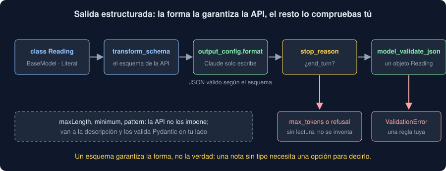

# 03 · Salida estructurada

⏱️ 50 min

## 🎯 Objetivos

- Entender por qué pedir JSON en el prompt no basta.
- Imponer la forma de la respuesta con un esquema JSON en `output_config`.
- Escribir el esquema con Pydantic y leer la respuesta como un objeto.
- Saber qué garantiza el esquema y qué tienes que comprobar tú.

---

## 1. "Responde en JSON" funciona casi siempre

Un programa no lee frases: lee datos. Lo primero que se prueba es pedirlo en el prompt:

```text
Responde solo con un JSON: {"tipo": ..., "urgente": true o false, "resumen": ...}.
```

Casi siempre llega un JSON. A veces llega dentro de un bloque de código de Markdown (```` ```json ````), con un texto delante, sin un campo, o con `"urgente": "sí"`. En el ejercicio 03, una de cuatro respuestas no se puede leer con `json.loads`. En un programa que lee mil notas al día, "casi siempre" son unas cuantas excepciones diarias.

## 2. Un esquema en `output_config`

La API puede **imponer** la forma: con un esquema JSON en `output_config.format`, el modelo solo puede escribir tokens que lo cumplan (*constrained decoding*). La respuesta es un JSON válido según el esquema, siempre que termine.

```python
SCHEMA = {
    "type": "object",
    "properties": {
        "tipo": {"type": "string", "enum": ["averia", "limpieza", "calibracion"]},
        "urgente": {"type": "boolean"},
        "resumen": {"type": "string"},
    },
    "required": ["tipo", "urgente", "resumen"],
    "additionalProperties": False,
}
response = client.messages.create(
    model="claude-sonnet-5-5",
    max_tokens=300,
    system=SYSTEM,
    messages=[{"role": "user", "content": note}],
    output_config={"format": {"type": "json_schema", "schema": SCHEMA}},
)
data = json.loads(response.content[0].text)
```

- `enum`: solo uno de esos valores. Un tipo inventado no puede salir.
- `required` y `additionalProperties: false`: ni falta ni sobra un campo.
- `"type": "boolean"`: `true` o `false`.

## 3. El esquema con Pydantic

Escribir el esquema a mano es largo y se desincroniza del código que lo lee. Con una clase de Pydantic (semana 13), el SDK lo genera y valida la respuesta:

```python
from typing import Literal

from pydantic import BaseModel


class Reading(BaseModel):
    tipo: Literal["averia", "limpieza", "calibracion"]
    urgente: bool
    resumen: str


response = client.messages.parse(
    model="claude-sonnet-5-5",
    max_tokens=300,
    system=SYSTEM,
    messages=[{"role": "user", "content": note}],
    output_format=Reading,
)
reading = response.parsed_output  # un Reading: reading.urgente es un bool
```

Las descripciones de `Field(description=...)` van en el esquema, y Claude las lee: son parte del prompt. `str | None` es un campo que puede faltar ("el equipo, si la nota lo dice"); `list[str]`, una lista ("una acción por elemento").

En el proyecto, los tipos dependen de tus notas: el modelo de Pydantic se crea al ejecutar, con `create_model` y `Literal[classes]` (teoría 05).

## 4. Lo que el esquema no garantiza



**No todas las reglas de JSON Schema.** La API admite tipos, `enum`, objetos, listas, `required`, `anyOf`; no admite, por ejemplo, `maxLength`, `minimum` o `pattern`. `anthropic.transform_schema`, que `parse` usa por dentro, las pasa a la descripción:

```text
{'type': 'string', 'title': 'Resumen', 'description': '{maxLength: 40}'}
```

Claude las lee como una petición, no como una obligación. Pydantic sí las comprueba al validar: un resumen de 76 caracteres da `ValidationError` en tu lado (ejercicio 03, paso 5). Las reglas que importan se comprueban en tu código.

**No una respuesta que no termina.** El esquema obliga a la forma mientras escribe, pero si se acaba `max_tokens`, el JSON queda a medias; si Claude se niega (`refusal`), no hay JSON. Por eso se mira `stop_reason` **antes** de leer:

```python
config = {"format": {"type": "json_schema", "schema": anthropic.transform_schema(Reading)}}
response = client.messages.create(..., output_config=config)
if response.stop_reason == "end_turn":
    reading = Reading.model_validate_json(response.content[0].text)
else:
    reading = None  # cortada o rechazada: no se inventa
```

Con una respuesta cortada, `messages.parse` lanza un error al validar, y pierdes la respuesta y los tokens que costó. El proyecto usa `create` con `transform_schema` y valida él, solo si terminó.

**No la verdad.** "Revisión de rutina en Este, todo normal" no tiene tipo, y con `tipo` obligatorio entre tres valores, sale uno: el esquema garantiza la forma, no que el contenido sea cierto. Si un campo puede no tener respuesta, el esquema necesita una forma de decirlo: `None`, o un valor como `desconocido`.

## 5. Herramientas estrictas

Hay otra forma de obtener datos con forma fija: una herramienta con `strict: true` (teoría 04). Su entrada cumple el esquema igual que una salida estructurada. Úsala cuando Claude tenga que **elegir** entre varias acciones; para "lee esto y dame estos campos", `output_config.format`.

## ⚠️ Errores comunes

| Error | Consecuencia | Mejor |
|---|---|---|
| Pedir JSON solo en el prompt | Respuestas que `json.loads` no lee, de vez en cuando | `output_config.format` con un esquema |
| Un esquema sin `enum` para un campo con pocos valores | Valores inventados o con otra ortografía | `enum`, o `Literal` en Pydantic |
| Confiar en `maxLength` o `minimum` | Respuestas que no los cumplen | Validar con Pydantic en tu código |
| Leer sin mirar `stop_reason` | JSON a medias o una negativa tratados como datos | Leer solo si es `end_turn` |
| Usar `parse` donde las respuestas pueden cortarse | Un error que se lleva la respuesta y su coste | `create` con `transform_schema` y validar tú |
| Un campo obligatorio que la nota puede no tener | Valores inventados para rellenarlo | `None` o un valor `desconocido` |

## ✅ Qué debes saber al terminar

- Por qué pedir JSON en el prompt no basta.
- Qué hace `output_config.format` y qué es el *constrained decoding*.
- Cómo se escribe el esquema con Pydantic y qué devuelve `messages.parse`.
- Qué reglas no impone la API, y dónde se comprueban.
- Por qué se mira `stop_reason` antes de validar.
- Que un esquema garantiza la forma, no la verdad.

---

## 🔗 Navegación

| Anterior | Actual | Siguiente |
| -------- | ------ | --------- |
| [02 · Prompting](02-prompting.md) | **03 · Salida estructurada** | [04 · Tool use](04-tool-use.md) |
