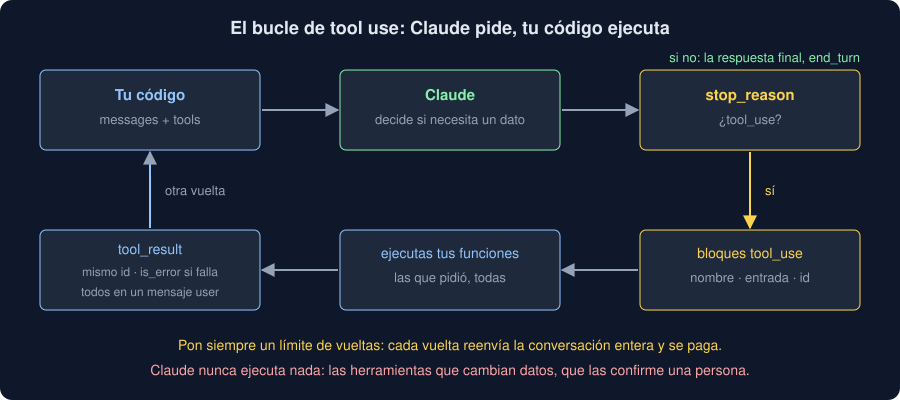

# 04 · Tool use

⏱️ 50 min

## 🎯 Objetivos

- Entender qué es una herramienta y quién la ejecuta.
- Describir una herramienta: nombre, descripción y esquema de la entrada.
- Escribir el bucle: pedir, ejecutar, devolver, repetir.
- Tratar los errores de las herramientas y poner límites.
- Saber qué herramientas no se dan sin una persona en medio.

---

## 1. Claude pide, tu código ejecuta

Claude no tiene tus medidas, ni tu base de datos, ni la hora. Con **herramientas** (*tool use*, también *function calling*), le describes funciones de tu programa; cuando necesita una, en lugar de responder, **pide** que la ejecutes, con qué entrada. Tu código la ejecuta y le devuelve el resultado. Claude nunca ejecuta nada: solo escribe una petición con forma de datos.



## 2. Describir una herramienta

```python
TOOLS = [
    {
        "name": "estadisticas",
        "description": "Número de medidas, media, mínimo y máximo de PM2.5 (µg/m³) de una estación.",
        "input_schema": {
            "type": "object",
            "properties": {
                "etiqueta": {"type": "string", "description": "La etiqueta de la estación, por ejemplo Norte."}
            },
            "required": ["etiqueta"],
            "additionalProperties": False,
        },
        "strict": True,
    },
]
```

- **`name`**: cómo la pide.
- **`description`**: cuándo usarla y qué devuelve, con sus unidades. Es lo único que Claude sabe de ella: escríbela como la documentación de una función para alguien que no puede leer el código.
- **`input_schema`**: un esquema JSON de la entrada, como el de la teoría 03.
- **`strict: true`**: la entrada cumplirá el esquema exactamente. Sin él, casi siempre.

## 3. Una vuelta

Con `tools=TOOLS`, la pregunta "¿Cuál es la media de PM2.5 en Norte?" no se responde con texto:

```text
stop_reason: tool_use
texto: Consulto las estadísticas de Norte.
tool_use: estadisticas({'etiqueta': 'Norte'}) · id toolu_df80f62427ae0447b4b4a647
```

Tu código ejecuta la función y envía otra petición con la conversación entera:

1. la pregunta (`user`);
2. la respuesta de Claude, **tal cual**, con su bloque `tool_use` (`assistant`);
3. un mensaje `user` con un bloque `tool_result`: el mismo `tool_use_id` y el resultado, como texto.

```python
messages = [
    {"role": "user", "content": "¿Cuál es la media de PM2.5 en Norte?"},
    {"role": "assistant", "content": response.content},
    {"role": "user", "content": [
        {"type": "tool_result", "tool_use_id": call.id, "content": json.dumps(result)},
    ]},
]
```

Ahora Claude tiene el dato y responde: `stop_reason: end_turn`.

## 4. El bucle

Una pregunta puede necesitar varias herramientas, y una puede depender de otra. El bucle repite la vuelta mientras `stop_reason` sea `tool_use`:

```python
for turn in range(1, turns + 1):
    response = client.messages.create(model=MODEL, max_tokens=1000, tools=TOOLS, messages=messages)
    if response.stop_reason != "tool_use":
        return response  # la respuesta final
    messages.append({"role": "assistant", "content": response.content})
    results = [run_tool(block) for block in response.content if block.type == "tool_use"]
    messages.append({"role": "user", "content": results})
```

Cuatro reglas:

- **Varias a la vez.** Si las herramientas no dependen unas de otras, Claude pide varias en una respuesta: en el ejercicio 04, las cinco estaciones de golpe. Ejecútalas todas y devuelve **todos** los resultados en **un** mensaje.
- **Los errores, como resultado.** Si una herramienta falla, no tumbes el bucle: devuelve un `tool_result` con `is_error: True` y un mensaje útil (qué falló y qué valores valen). Claude lo lee y reacciona: con "Sureste", explica qué estaciones existen.
- **Un límite de vueltas.** Cada vuelta reenvía la conversación entera y se paga; un fallo puede encadenar vueltas sin fin. Pon un tope y decide qué hacer al llegar.
- **El orden de los mensajes.** Cada `tool_use` necesita su `tool_result` en el mensaje siguiente, con el mismo id; si no, la API responde 400.

## 5. Elegir la herramienta

`tool_choice` decide si Claude puede usar herramientas:

- `{"type": "auto"}`, por defecto: decide él;
- `{"type": "none"}`: ninguna en esta petición.

Forzar una herramienta concreta (`{"type": "tool", ...}` o `{"type": "any"}`) no se admite en Sonnet 5.5 ni en Opus 5.5: la API responde 400. Si necesitas que use una, dilo en el prompt; si lo que quieres es un JSON con forma fija, usa la salida estructurada (teoría 03).

## 6. El *tool runner*

El SDK trae el bucle hecho: `@beta_tool` crea la herramienta a partir de una función (el nombre, el docstring y los tipos), y `client.beta.messages.tool_runner(...)` repite las vueltas por ti:

```python
from anthropic import beta_tool


@beta_tool
def estadisticas(etiqueta: str) -> str:
    """Número de medidas, media, mínimo y máximo de PM2.5 (µg/m³) de una estación.

    Args:
        etiqueta: La etiqueta de la estación, por ejemplo Norte.
    """
    return json.dumps(statistics_of(etiqueta))


runner = client.beta.messages.tool_runner(
    model=MODEL, max_tokens=1000, tools=[estadisticas], messages=messages
)
for message in runner:  # una vuelta en cada iteración
    print(message.stop_reason)
```

Es **beta**: su forma puede cambiar entre versiones del SDK. El bucle a mano es más largo, pero lo controlas entero: los errores, el límite, qué se registra. La semana 39 (agentes y MCP) vuelve sobre los dos.

## 7. Herramientas con cuidado

Una herramienta es código tuyo que se ejecuta cuando lo pide un modelo, a partir de lo que ha leído. Si ha leído una nota con una inyección de prompt (teoría 02), puede pedir lo que la nota diga.

- **De solo lectura, mejor.** Consultar medidas o notas no rompe nada.
- **Las que cambian algo, con confirmación.** Borrar, guardar, enviar o pagar: que una persona lo apruebe antes de ejecutarlo.
- **Lo mínimo.** Una herramienta `sql(consulta)` lo puede todo; `estadisticas(etiqueta)` solo una cosa. Cuanto más concreta, menos daño puede hacer.
- **Valida la entrada** como validarías la de un formulario: es una entrada de fuera.

## ⚠️ Errores comunes

| Error | Consecuencia | Mejor |
|---|---|---|
| Descripciones vagas ("obtiene datos") | Claude no sabe cuándo usarla o la usa mal | Qué hace, qué devuelve y en qué unidades |
| Devolver los resultados en mensajes separados | Claude deja de pedir herramientas en paralelo | Todos los `tool_result` de una vuelta en un mensaje |
| Dejar que un error tumbe el bucle | Una pregunta sin respuesta por un dato que falta | `tool_result` con `is_error: True` y un mensaje útil |
| Un bucle sin límite | Un gasto sin techo | Un número máximo de vueltas |
| Herramientas que borran o envían sin confirmación | Una nota maliciosa puede hacerlo | Confirmación de una persona, y herramientas de solo lectura |
| Forzar una herramienta con `tool_choice` en Sonnet 5.5 | `BadRequestError` 400 | `auto` y pedirla en el prompt |

## ✅ Qué debes saber al terminar

- Qué es una herramienta y por qué Claude nunca ejecuta nada.
- Qué lleva la descripción de una herramienta y para qué sirve `strict`.
- Cómo es una vuelta: `tool_use`, tu ejecución, `tool_result` con el mismo id.
- Cómo es el bucle, con herramientas en paralelo, errores y un límite.
- Qué hace el *tool runner* y por qué es beta.
- Qué herramientas necesitan una persona en medio.

---

## 🔗 Navegación

| Anterior | Actual | Siguiente |
| -------- | ------ | --------- |
| [03 · Salida estructurada](03-salida-estructurada.md) | **04 · Tool use** | [05 · Claude en tu Observatorio](05-claude-en-tu-observatorio.md) |
