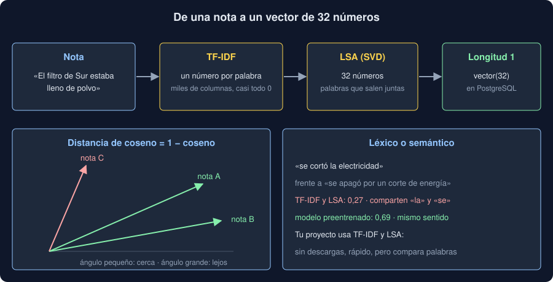

# 01 · Embeddings: textos que se pueden medir

⏱️ 50 min

## 🎯 Objetivos

- Entender qué es un *embedding* y para qué sirve compararlos.
- Medir la cercanía entre dos vectores con el coseno y la distancia de coseno.
- Convertir textos en vectores con TF-IDF y reducirlos con LSA.
- Distinguir la búsqueda léxica de la semántica y saber qué aporta un modelo preentrenado.
- Elegir cómo sacar los vectores: local y simple, un modelo descargado o una API.

## 1. Un texto, una lista de números

Un **embedding** es una lista de números de longitud fija que representa un texto. La idea es que textos parecidos tengan vectores cercanos. Así, «¿qué notas se parecen a esta?» deja de ser una pregunta de lenguaje y pasa a ser una pregunta de geometría: ¿qué vectores están más cerca de este?

Ya has visto vectores de texto en el bootcamp:

- **semana 36:** TF-IDF para clasificar notas, y los vectores de un *encoder* (el modelo multilingüe del ejercicio 03);
- **semana 31:** k-NN, que clasifica un punto por sus vecinos más cercanos.

Esta semana juntas las dos ideas: guardas un vector por nota y buscas las vecinas de una pregunta.



## 2. Coseno: el ángulo, no el tamaño

Dos notas sobre el mismo tema, una corta y otra larga, tienen vectores de tamaños distintos que apuntan en una dirección parecida. Por eso, para textos, se mide el **ángulo** entre vectores:

```python
import numpy as np

def cosine(a: np.ndarray, b: np.ndarray) -> float:
    return float(a @ b / (np.linalg.norm(a) * np.linalg.norm(b)))
```

- **Coseno 1:** apuntan igual. **0:** no comparten nada (perpendiculares).
- **Distancia de coseno** = 1 − coseno: 0 si son iguales, y crece cuanto más lejos. Es lo que calcula el operador `<=>` de pgvector (teoría 02).

Si los vectores tienen **longitud 1** (se dividen por su norma), el coseno es el producto escalar `a @ b`, más barato. Además, la distancia euclídea al cuadrado es 2 − 2 × coseno: ordenar por una o por la otra da el mismo orden. Por eso los vectores de tu proyecto se normalizan antes de guardarse.

## 3. TF-IDF: contar palabras con criterio

La forma más simple de convertir un texto en vector es contar sus palabras: una columna por palabra del vocabulario. Contar a secas da el mismo peso a «el» que a «polvo». **TF-IDF** multiplica cada recuento por lo rara que es la palabra en el conjunto (semana 36):

```python
from sklearn.feature_extraction.text import TfidfVectorizer

vectorizer = TfidfVectorizer(strip_accents="unicode", sublinear_tf=True)
matrix = vectorizer.fit_transform(notes)   # una fila por nota, una columna por palabra
```

- `strip_accents="unicode"` hace que «calibración» y «calibracion» sean la misma palabra.
- `sublinear_tf=True` usa 1 + log(recuento): una palabra repetida diez veces no pesa diez veces más.
- Las filas ya salen con longitud 1.

El problema es el tamaño: con 300 notas hay cientos de columnas, casi todas 0 en cada fila. Y dos notas solo se parecen si comparten **las mismas** palabras.

## 4. LSA: de muchas columnas a pocos números

**LSA** (*Latent Semantic Analysis*) aplica una SVD truncada a la matriz TF-IDF (como el PCA de la semana 33, pero sin centrar los datos: centrar una matriz dispersa la llenaría de números). Resume las columnas en `n` números por nota:

```python
from sklearn.decomposition import TruncatedSVD
from sklearn.pipeline import make_pipeline
from sklearn.preprocessing import Normalizer

embedder = make_pipeline(
    TfidfVectorizer(strip_accents="unicode", sublinear_tf=True),
    TruncatedSVD(32, random_state=0),
    Normalizer(),   # longitud 1 otra vez: la SVD la cambia
)
vectors = embedder.fit_transform(notes)   # (n_notas, 32)
```

Cada uno de los 32 números mezcla palabras que **salen juntas** en las notas. Si «filtro», «polvo» y «limpio» aparecen en las mismas notas, LSA las junta, y dos notas de limpieza se acercan aunque no compartan palabras exactas. En el ejercicio 01, dos notas pasan de coseno 0,36 con TF-IDF a 0,81 con LSA.

Dos condiciones prácticas:

- `TruncatedSVD(32)` necesita más de 32 notas y más de 32 palabras distintas: no puede sacar más números que filas o columnas tenga la matriz.
- El modelo se **ajusta** con tus notas. Para comparar una pregunta con ellas, hay que transformarla con el **mismo** modelo ajustado. Si reajustas con otras notas, los 32 números significan otra cosa y los vectores viejos no valen.

## 5. Léxico frente a semántico

TF-IDF y LSA son **léxicos**: comparan palabras. LSA amplía un poco qué cuenta como parecido, pero solo con las palabras que ha visto en tus notas. «se cortó la electricidad» y «se apagó por un corte de energía» no comparten ninguna palabra con contenido, y para TF-IDF se parecen solo por «la» y «se».

Un modelo de embeddings **preentrenado** es un *encoder* (semana 36) entrenado con millones de pares de frases que dicen lo mismo. Compara **sentidos**: en el ejercicio 01, esas dos frases tienen coseno 0,69 con el modelo multilingüe y 0,27 con TF-IDF. Sobre cuatro consultas escritas con otras palabras, el modelo acierta el tipo de las cuatro, y TF-IDF, de dos.

| | TF-IDF + LSA | Modelo descargado | API de embeddings |
|---|---|---|---|
| Qué compara | Palabras | Sentidos | Sentidos |
| Qué necesita | scikit-learn | PyTorch y unos cientos de MB | Una clave y red |
| Se ajusta con tus datos | Sí: hay que guardar o rehacer el modelo | No: es fijo | No: es fijo |
| Coste por texto | Nada | CPU o GPU | Céntimos por millón de tokens |
| Los textos salen de tu máquina | No | No | Sí |

Anthropic no ofrece un modelo de embeddings propio: su documentación recomienda proveedores como Voyage AI. Para tu proyecto, el bootcamp elige TF-IDF y LSA: funciona sin red, sin descargas ni claves, y con notas que repiten el vocabulario de tu dominio acierta tanto como `clasificar`. El límite está medido: cuando la pregunta usa otras palabras que las notas, falla, y el siguiente paso sería un modelo preentrenado.

## 6. Un vector no es una explicación

Que dos vectores estén cerca dice que, para ese modelo, los textos se parecen. No dice **por qué**, ni que el parecido sea el que te importa. En el proyecto lo verás: «el sensor no envía datos» trae tres calibraciones que dicen «el sensor ... no responde igual». Las palabras coinciden y el sentido no. Por eso una búsqueda se **mide** (teoría 04) en lugar de darla por buena.

## ⚠️ Errores comunes

| Error | Por qué falla | Qué hacer |
|---|---|---|
| Comparar con distancia euclídea vectores sin normalizar | Una nota larga queda lejos de una corta aunque hablen de lo mismo | Normaliza a longitud 1, o usa el coseno |
| Reajustar el modelo para cada pregunta | La pregunta y las notas quedan en espacios distintos | Ajusta con las notas y transforma la pregunta con el mismo modelo |
| Mezclar vectores de dos modelos | Cada modelo tiene sus propios ejes: comparar sus números no tiene sentido | Un modelo por columna; si cambias de modelo, recalcula todo |
| Esperar que TF-IDF encuentre sinónimos | Compara palabras, y «apagón» no es «corte» | Mide con preguntas de otras palabras; si fallan, cambia de modelo |
| Pedir 32 componentes con 20 notas | La SVD no puede sacar más números que filas | Indexa más notas, o baja la dimensión |

## ✅ Qué debes saber al terminar

- Un embedding representa un texto con un vector, y textos parecidos tienen vectores cercanos.
- Distancia de coseno = 1 − coseno; con longitud 1, el coseno es un producto escalar.
- TF-IDF pesa las palabras raras; LSA resume las columnas en pocos números que juntan palabras que salen juntas.
- El modelo que hace los vectores se ajusta con tus notas y hay que usar el mismo para las preguntas.
- Léxico compara palabras, semántico compara sentidos, y cada opción tiene un coste distinto.

---

## 🔗 Navegación

| Anterior | Actual | Siguiente |
| -------- | ------ | --------- |
| [Semana 38](../README.md) | **01 · Embeddings** | [02 · pgvector](02-pgvector.md) |
