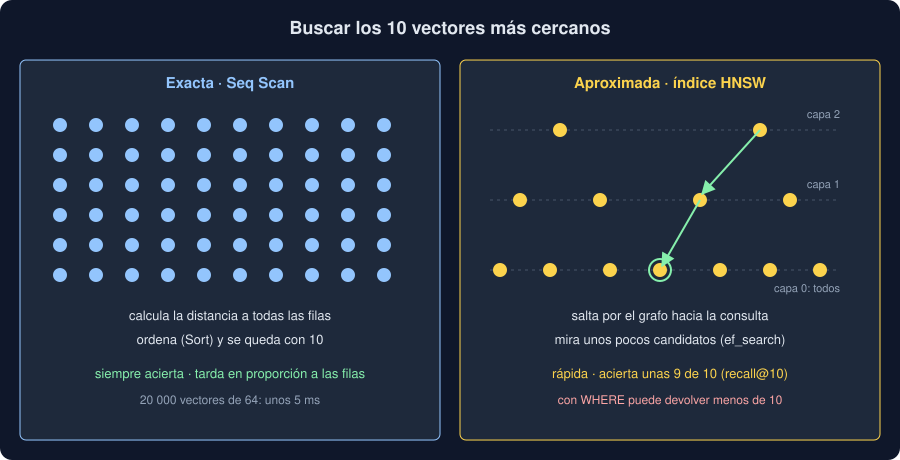

# 02 · pgvector: vectores en PostgreSQL

⏱️ 50 min

## 🎯 Objetivos

- Instalar la extensión pgvector y entender por qué cambia la imagen de Docker.
- Guardar vectores en una columna `vector(n)` con SQL, psycopg y SQLAlchemy.
- Elegir el operador de distancia y buscar los `k` más cercanos con `ORDER BY ... LIMIT`.
- Distinguir la búsqueda exacta de la aproximada con un índice HNSW.
- Ajustar `ef_search` y evitar que un filtro deje la búsqueda con menos filas.

## 1. Por qué en PostgreSQL

Para buscar vectores parecidos hay bases especializadas (las *vector databases*). Pero tus notas ya viven en PostgreSQL desde la semana 19, con sus migraciones, su copia de seguridad y sus tests. Con **pgvector**, el vector es una columna más de la misma fila:

- una sola base que operar, y transacciones que cubren la nota y su vector;
- `WHERE`, `JOIN` y filtros de SQL junto a la búsqueda por cercanía;
- el mismo PostgreSQL en desarrollo, en los tests y en la CI.

pgvector es una **extensión**: código C que se carga en el servidor y añade un tipo, operadores e índices. Por eso no basta con `uv add pgvector`: ese paquete de Python solo enseña el tipo a SQLAlchemy y a psycopg. El servidor necesita la extensión compilada, y la imagen oficial `postgres` no la trae. Tu `compose.yaml` pasa a la imagen `pgvector/pgvector`, que es PostgreSQL 18 con la extensión ya instalada.

## 2. Instalar la extensión

La imagen trae la extensión **disponible**. Cada base la **instala** una vez:

```sql
CREATE EXTENSION IF NOT EXISTS vector;
SELECT extversion FROM pg_extension WHERE extname = 'vector';   -- 0.8.7
```

- En tu proyecto, esa línea va en la migración `0002`, antes de crear la tabla. Sin ella, PostgreSQL responde `type "vector" does not exist`.
- `CREATE EXTENSION` necesita permisos de administrador de la base. En tu Docker los tienes; en un PostgreSQL gestionado, a veces hay que pedirlo o activarlo en el panel.
- En la imagen de otro PostgreSQL sin pgvector, el error es `extension "vector" is not available`.

## 3. Una columna `vector(n)`

```sql
CREATE TABLE notes (
    id        bigint GENERATED ALWAYS AS IDENTITY PRIMARY KEY,
    text      text NOT NULL,
    embedding vector(32) NOT NULL
);
INSERT INTO notes (text, embedding) VALUES ('filtro sucio', '[0.1, 0.3, ...]');
```

`vector(32)` admite exactamente 32 números de 4 bytes (`float32`), como `varchar(100)` admite 100 caracteres. Un vector de otro tamaño es un error: `expected 32 dimensions, not 2`.

Desde Python:

- **psycopg:** `register_vector(conn)` hace que un array de NumPy se envíe como `vector` y que un `vector` vuelva como un objeto de pgvector.
- **SQLAlchemy:** la columna es `Vector(32)`, y en el modelo llega como array de NumPy.

```python
from pgvector.sqlalchemy import Vector

class Note(Base):
    __tablename__ = "notes"
    id: Mapped[int] = mapped_column(primary_key=True)
    text: Mapped[str] = mapped_column(Text)
    embedding: Mapped[NDArray[np.float32]] = mapped_column(Vector(32))
```

## 4. Distancias y búsqueda exacta

| Operador | Método en SQLAlchemy | Distancia |
|---|---|---|
| `<->` | `l2_distance` | Euclídea |
| `<=>` | `cosine_distance` | 1 − coseno |
| `<#>` | `max_inner_product` | Producto escalar con el signo cambiado |

`<#>` cambia el signo porque PostgreSQL ordena de menor a mayor y el producto más grande debe salir primero. Buscar las 5 notas más cercanas es SQL de siempre:

```sql
SELECT id, text, embedding <=> %(query)s AS distance
FROM notes
ORDER BY distance, id
LIMIT 5;
```

```python
distance = Note.embedding.cosine_distance(vector)
rows = session.execute(
    select(Note, distance).order_by(distance, Note.id).limit(k)
).all()
```

Sin índice, PostgreSQL calcula la distancia a **todas** las filas (`Seq Scan`), las ordena (`Sort`) y se queda con `k`. Es la búsqueda **exacta**: siempre devuelve las `k` más cercanas de verdad. El `Note.id` del final desempata: a igual distancia, el orden no depende de cómo estén guardadas las filas.

¿Es lenta? Tarda en proporción al número de filas. Con 20 000 vectores de 64 números, unos 5 ms (ejercicio 02). Con las 240 notas de tu proyecto, menos de un milisegundo.

## 5. HNSW: búsqueda aproximada

Con millones de filas, recorrerlas todas en cada pregunta ya no vale. Un **índice HNSW** (*Hierarchical Navigable Small World*) es un grafo en capas: cada vector está unido a sus vecinos más cercanos, y la capa de arriba tiene pocos vectores con enlaces largos. Para buscar, se entra por arriba y se salta hacia la consulta, bajando de capa, sin mirar la mayoría de las filas.



```sql
CREATE INDEX notes_embedding_hnsw ON notes USING hnsw (embedding vector_cosine_ops);
```

- El índice es **para un operador**: `vector_cosine_ops` sirve a `<=>`; para `<->` haría falta `vector_l2_ops`.
- Es **aproximado**: puede saltarse alguna de las `k` más cercanas. Se mide con **recall@k**, la parte de las verdaderas `k` más cercanas que devuelve. En el ejercicio 02, unas 9 de 10.
- Crearlo es caro (segundos con 20 000 filas, más con millones) y ocupa memoria. Las inserciones también se vuelven más lentas.
- La otra opción de pgvector, **IVFFlat**, agrupa los vectores con k-means (semana 33) y busca solo en los grupos más cercanos. Se crea más rápido, pero hay que crearla **después** de cargar los datos.

Tu proyecto **no** crea índice: con 240 notas, la búsqueda exacta es instantánea y nunca se equivoca. Un índice se añade cuando se mide que hace falta.

## 6. `ef_search`, y filtrar

`hnsw.ef_search` es cuántos candidatos guarda el índice mientras busca (40 por defecto). Más candidatos, más acierto y más tiempo:

```sql
SET hnsw.ef_search = 100;
```

En el ejercicio 02: 10 candidatos aciertan 0,75; 40, 0,92; 200, 0,99.

Al **filtrar**, el índice saca sus candidatos y **después** se aplica el `WHERE`. Si solo uno de cada diez cumple, de 40 candidatos quedan unos 4, y la consulta devuelve menos filas de las pedidas aunque haya miles que cumplen. Desde pgvector 0.8, el escaneo iterativo sigue buscando hasta llenar el `LIMIT`:

```sql
SET hnsw.iterative_scan = relaxed_order;
```

Con `relaxed_order`, los resultados pueden salir ligeramente desordenados; con `strict_order`, no, pero tarda más.

## 7. La imagen y los datos

Cambiar de imagen tiene un detalle: la oficial que usabas era Alpine, y `pgvector/pgvector` es Debian. Alpine ordena el texto con musl y Debian con glibc. Un índice sobre una columna de texto, creado con una, puede quedar mal ordenado con la otra. Con datos de desarrollo que se regeneran en un minuto, lo más simple es borrar el volumen (`docker compose down -v`) y migrar de nuevo. En producción se haría un volcado y una restauración (`pg_dump` y `pg_restore`), que reconstruyen los índices.

## ⚠️ Errores comunes

| Error | Por qué falla | Qué hacer |
|---|---|---|
| `uv add pgvector` y nada más | El paquete de Python no instala la extensión en el servidor | Usa una imagen con pgvector y `CREATE EXTENSION` en una migración |
| Índice con `vector_l2_ops` y consulta con `<=>` | El índice no sirve a ese operador: PostgreSQL hace `Seq Scan` | Crea el índice con el operador de tus consultas |
| Crear un índice HNSW con pocas filas | Paga el coste y la aproximación sin ganar nada | Mide primero la búsqueda exacta |
| `WHERE` con un índice y pocos resultados | El filtro se aplica después del índice | `hnsw.iterative_scan`, o prueba sin índice |
| Ordenar solo por distancia | Los empates salen en cualquier orden, y los tests fallan a veces | Desempata con la clave primaria |

## ✅ Qué debes saber al terminar

- pgvector es una extensión del servidor: la imagen la trae y cada base la instala con `CREATE EXTENSION`.
- `vector(n)` guarda `n` números, y psycopg y SQLAlchemy lo convierten en arrays de NumPy.
- `<=>` es la distancia de coseno, y `ORDER BY ... LIMIT k` es una búsqueda exacta.
- HNSW es aproximado y rápido; se mide con recall@k y se ajusta con `ef_search`.
- Un filtro con un índice puede devolver menos filas, y `iterative_scan` lo arregla.

---

## 🔗 Navegación

| Anterior | Actual | Siguiente |
| -------- | ------ | --------- |
| [01 · Embeddings](01-embeddings.md) | **02 · pgvector** | [03 · RAG](03-rag.md) |
