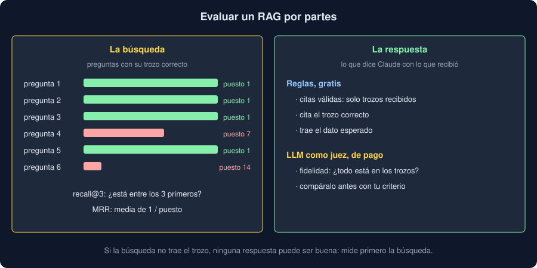

# 04 · Evaluar un RAG

⏱️ 45 min

## 🎯 Objetivos

- Evaluar la búsqueda y la respuesta por separado.
- Construir un conjunto de preguntas etiquetadas.
- Calcular precisión@k, recall@k y MRR, y leer qué dicen.
- Comprobar respuestas con reglas y con un LLM como juez.
- Usar las medidas para decidir: troceo, `k`, modelo de embeddings.

## 1. Dos partes, dos medidas

Un RAG puede fallar en dos sitios:

- **La búsqueda** no trae el fragmento que responde. Claude no puede usar lo que no recibe.
- **La respuesta** no usa bien lo que recibe: lo ignora, lo contradice o añade cosas que no están.

Si solo miras la respuesta final, no sabes cuál de las dos falló. Por eso se miden por separado, y **primero la búsqueda**: es más barata de medir (no llama a Claude) y pone el techo a todo lo demás.



## 2. Un conjunto de preguntas etiquetadas

Para medir hace falta saber la respuesta correcta. Un conjunto de evaluación es una lista de preguntas, cada una con:

- el fragmento, o los fragmentos, que la responden: la **etiqueta**;
- si quieres medir la respuesta, el dato que debe contener.

Escribirlo es la parte cara: hay que conocer los documentos. Consejos:

- Preguntas como las que haría una persona, **también con otras palabras** que el documento. Si todas copian el texto, la búsqueda léxica parecerá perfecta.
- Preguntas que el documento **no** responde, para ver si el sistema dice «no lo sé».
- Etiquetas que se puedan comprobar en código. En el ejercicio 04, una frase que solo está en el fragmento bueno: si la frase sale en dos fragmentos o en ninguno, la etiqueta está mal escrita y el código falla.

Doce preguntas sirven para aprender; un conjunto de verdad tiene decenas o cientos, y crece cada vez que alguien encuentra un fallo.

## 3. Medir la búsqueda

Para cada pregunta, la búsqueda devuelve una lista ordenada. Tres medidas:

| Medida | Qué cuenta | Pregunta que responde |
|---|---|---|
| **Precisión@k** | Parte de los `k` resultados que son relevantes | ¿Cuánto ruido llega al prompt? |
| **Recall@k** | Parte de los relevantes que están entre los `k` primeros | ¿Llega lo que hace falta? |
| **MRR** | Media de 1 / puesto del primer relevante | ¿Sale arriba? |

```python
def recall_at(ranks: list[int], k: int) -> float:
    return sum(rank <= k for rank in ranks) / len(ranks)

def mrr(ranks: list[int]) -> float:
    return sum(1 / rank for rank in ranks) / len(ranks)
```

En RAG, **recall@k** es la que más importa: si el fragmento bueno no está entre los `k`, la respuesta no puede ser buena. Con un solo fragmento relevante por pregunta, recall@k también se llama *hit rate*@k.

**Mira los fallos uno a uno**, además de la media. En el ejercicio 04, recall@3 es 0,58, y los cinco fallos son preguntas con otras palabras («apagón», «repuesto», «sin corriente»). Eso dice qué arreglar: no hace falta otro troceo, sino un modelo que entienda sinónimos.

### Cuando las etiquetas ya existen

En tu Observatorio, cada nota tiene un **tipo** (avería, calibración, limpieza). Sin escribir preguntas, la búsqueda se mide con las notas de prueba:

- **Precisión@k:** de las `k` vecinas de una nota de prueba, ¿cuántas son de su tipo?
- **Voto:** ¿el tipo más repetido entre las `k` vecinas es el suyo? Es un clasificador k-NN (semana 31), y se compara con `clasificar` y `leer-notas` sobre las mismas 60 notas.

Las notas de prueba **no** se indexan. Si estuvieran, cada una se encontraría a sí misma a distancia 0, y la medida sería mentira: es la fuga de datos de la semana 31.

## 4. Medir la respuesta con reglas

Antes de pagar por un juez, comprueba lo que se puede comprobar con código:

- **Citas válidas:** todas son de fragmentos que recibió.
- **Cita correcta:** entre las citas está el fragmento etiquetado.
- **Trae el dato:** el texto contiene el valor esperado («30 días», «50 Pa»).
- **Dice que no** cuando la pregunta no tiene respuesta: citas vacías.

Son gratis y deterministas, y caben en los tests. Pero se engañan: «trae el dato» acepta una respuesta que menciona el dato por otro motivo (ejercicio 04, paso 5).

## 5. Un LLM como juez

**Fidelidad** (*faithfulness*, o *groundedness*): todo lo que afirma la respuesta está en los fragmentos. Ninguna regla de texto la mide bien, así que se pregunta a un modelo:

```python
class Verdict(BaseModel):
    fiel: bool = Field(description="Si todo lo que dice la respuesta está en los fragmentos.")
    motivo: str = Field(description="Por qué, en 20 palabras o menos.")

JUDGE = "\n".join(
    [
        "Revisas respuestas de un asistente que solo debe usar los fragmentos que recibe.",
        "Una respuesta es fiel si todo lo que afirma está en los fragmentos.",
        "Una respuesta incompleta puede ser fiel; una que añade algo que no está, no.",
    ]
)
```

- El juez recibe **los mismos fragmentos** y la respuesta, y devuelve un veredicto con salida estructurada.
- Una pregunta concreta (¿añade algo que no está?) da veredictos más estables que «puntúa del 1 al 10».
- **El juez también se equivoca.** Antes de fiarte, compara sus veredictos con los tuyos en una muestra. Si no coincidís, cambia el prompt del juez, no tu criterio.
- **Cuesta:** el juez lee otra vez los fragmentos. En el ejercicio 04, juzgar cuesta tanto como responder. Con cien preguntas en cada cambio, es parte del presupuesto.

Otras medidas habituales: **relevancia de la respuesta** (¿responde a lo que se preguntó?) y **completitud** (¿trae todo lo necesario?). Bibliotecas como Ragas las empaquetan, pero son prompts de juez como este: entiende uno antes de usar cien.

## 6. Decidir con números

Con el conjunto y las medidas, cada cambio se compara con el anterior:

| Cambio | Qué mirar |
|---|---|
| Otro troceo (párrafos o secciones) | Recall@k y los tokens del prompt. En el ejercicio 04, las secciones suben recall@3 de 0,58 a 1,00 con fragmentos un 50 % más largos |
| Otro `k` | Recall@k frente a coste |
| Otro modelo de embeddings | Recall@k en las preguntas con otras palabras |
| Otro prompt | Fidelidad, citas válidas y «no lo sé» |
| **Búsqueda híbrida** | Combinar la léxica (palabras exactas, nombres, códigos) con la semántica (sinónimos) suele ganar a las dos por separado |

Cambia una cosa cada vez, y guarda los números de cada versión. «Parece que responde mejor» no es una medida.

## ⚠️ Errores comunes

| Error | Por qué falla | Qué hacer |
|---|---|---|
| Medir solo la respuesta final | No sabes si falló la búsqueda o la generación | Mide la búsqueda primero |
| Preguntas que copian el documento | La búsqueda léxica parece perfecta | Incluye preguntas con otras palabras |
| Indexar las notas de prueba | Cada una se encuentra a sí misma | Indexa solo las de entrenamiento |
| Fiarse del juez sin comprobarlo | El juez también alucina | Compara con tus veredictos en una muestra |
| Mirar solo la media | Esconde qué tipo de pregunta falla | Lee los fallos uno a uno |

## ✅ Qué debes saber al terminar

- La búsqueda y la respuesta se miden por separado, y la búsqueda primero.
- Un conjunto de preguntas etiquetadas convierte cada cambio en una comparación.
- Recall@k dice si llega lo que hace falta; MRR, si sale arriba; precisión@k, cuánto ruido llega.
- Las reglas sobre citas y datos son gratis; la fidelidad necesita un juez, que también se mide.
- Los fallos, mirados uno a uno, dicen qué cambiar.

---

## 🔗 Navegación

| Anterior | Actual | Siguiente |
| -------- | ------ | --------- |
| [03 · RAG](03-rag.md) | **04 · Evaluar un RAG** | [05 · RAG en tu Observatorio](05-rag-en-tu-observatorio.md) |
